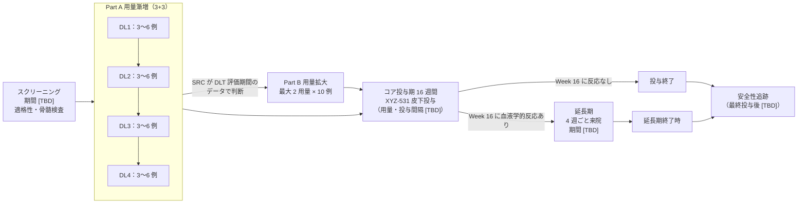

# Title Page

| 項目 | 内容 |
|---|---|
| 試験の正式名称 | 免疫抑制療法に不応の重症再生不良性貧血患者を対象とした XYZ-531（TPO 受容体作動性モノクローナル抗体）皮下投与の非盲検、用量漸増及び用量拡大、多施設共同第 1 相試験 [USER][DERIVED] |
| 略称 | [TBD] |
| 治験実施計画書番号 | [TBD] |
| 相 | 第 1 相（ヒト初回投与［FIH］）[USER] |
| 治験薬 | XYZ-531：トロンボポエチン（TPO）受容体作動性のモノクローナル抗体。eltrombopag と同じく、内因性 TPO と競合しない部位に結合する。皮下投与 [USER] |
| 規制上の識別番号（治験計画届出番号、jRCT 番号） | [TBD] |
| 治験依頼者の名称及び所在地 | [TBD] |
| 治験調整医師／医学専門家 | [TBD] |
| 版・作成日・改訂 | 草案 第 0.1 版、2026-10-25、改訂なし [DERIVED] |
| 実施国 | 日本 [USER] |

**秘密保持に関する記載.** 本書は治験依頼者の秘密情報を含む。治験審査委員会（IRB）による審査、治験責任医師・治験分担医師及び治験協力者による治験の実施、並びに参加候補者へのインフォームド・コンセントの取得に必要な範囲を除き、治験依頼者の書面による許可なく第三者に開示してはならない [STD]。

> 【草案についての注記】本書は「clinical-trial-protocol-skill v001.2」を第 1 相に拡張して作成した予備的な草案である。各段落・表の行の末尾の角括弧は出典ラベル（[USER] 利用者の設計、[CTG:…] ClinicalTrials.gov の登録情報、[PACK:aplastic_anemia] 下書きの疾患パック、[PRIOR:…] 公表資料、[STD] 規制・GCP の定型、[INSTR:…] 評価尺度の版、[DERIVED] 作成者が膨らませた記述（要レビュー）、[TBD] 治験依頼者が埋める値）を示す。設計上の判断とその理由は `design_decisions.md`（D1〜D12）に記録した [DERIVED]。

# 1 PROTOCOL SUMMARY

## 1.1 Protocol Synopsis

**試験の目的の要約.** 重症再生不良性貧血（SAA）は、免疫を介した造血幹細胞・前駆細胞の障害による致死的な骨髄不全である。ウマ抗胸腺細胞グロブリン（ATG）とシクロスポリン（CsA）を中心とする免疫抑制療法（IST）に不応の患者には治療選択肢が限られ、輸血依存と出血・感染のリスクが続く [PRIOR:NDA22291-S021:clinical-review-1.2][CTG:NCT00922883:brief_summary]。TPO 受容体作動薬（TPO-RA）は IST 不応例で 3 系統の血球回復をもたらすことが示されている [PRIOR:NDA22291-S021:label-14.3]。XYZ-531 は TPO 受容体を刺激するモノクローナル抗体であり、抗体の長い半減期により投与間隔を延ばせる可能性がある [USER][DERIVED]。本試験は、XYZ-531 をヒトに初めて投与し、IST に不応の SAA 患者での安全性・忍容性、薬物動態（PK）、免疫原性及び血液学的反応の予備的な兆候を評価し、拡大パート及び以後の試験の推奨用量を選ぶことを目的とする [USER][DERIVED]。

**目的、評価項目及び estimand.** 各評価項目の 5 属性は第 3 節に示す [DERIVED]。

| ID | 区分 | 評価項目 | 時点 |
|---|---|---|---|
| P1 | 主要 | Part A の DLT 評価期間における用量制限毒性（DLT）の発現 | DLT 評価期間 |
| P2 | 主要 | 治験薬投与下で発現した有害事象（TEAE）の発現割合と重症度（NCI CTCAE v6.0 で評価） | Week 16 |
| S1 | 副次 | XYZ-531 の単回及び反復皮下投与後の血清中薬物動態パラメータ（Cmax、Tmax、AUC、t1/2、Ctrough） | Week 16 |
| S2 | 副次 | XYZ-531 に対する抗薬物抗体（ADA）及び中和抗体の発現割合 | Week 16 |
| S3 | 副次 | Week 16 に血液学的反応を示した参加者の割合 | Week 16 |
| S4 | 副次 | Week 8 に血小板反応を示した参加者の割合 | Week 8 |
| S5 | 副次 | Week 16 までに血小板輸血非依存（8 週間以上連続して血小板輸血なし）を達成した参加者の割合 | Week 16 |
| E1 | 探索 | 血小板数、ヘモグロビン、好中球数及び網赤血球数のベースラインからの経時的変化 | Week 16 |
| E2 | 探索 | 血液学的反応までの期間及び血液学的反応の持続期間 | 延長期終了時 |
| E3 | 探索 | クローン進展（骨髄の新たな染色体異常、MDS/AML、PNH クローンの拡大）の発現割合 | 延長期終了時 |

主要目的は安全性・忍容性の評価と、Part B 及び以後の試験の推奨用量の選択であり、仮説検定は行わない [USER][STD]。副次評価項目 S3 には、中間事象（新たな免疫抑制療法、HSCT 又は他の TPO 受容体作動薬の開始等）を composite 戦略で扱う estimand を置く（第 3.2 節）[DERIVED]。

**試験デザインの概要.** 本試験は、日本の多施設で実施する非盲検、単群（用量コホートの逐次登録）の第 1 相試験であり、Part A（用量漸増）と Part B（用量拡大）から成る [USER]。
- Part A：3+3 法で用量を漸増する。1 コホート 3〜6 例。計画上は 4 用量段階を想定する（実際の段階数と各用量は [TBD]）[USER][STD][CTG:NCT02094417:arm_doses]。
- Part B：Part A で安全性評価委員会（SRC）が選んだ最大 2 用量で、各 10 例を追加して安全性・PK・血液学的反応の推定精度を高める [USER][CTG:NCT02094417:enrollment]。
- 投与：XYZ-531 を皮下投与する。開始用量（最小予測生物学的作用量［MABEL］に基づく）、用量段階及び投与間隔は [TBD]。投与間隔は参加者の利便性のため長い方が望ましい [USER]。
- 期間：スクリーニング期（[TBD]）、コア投与期 16 週間、Week 16 に血液学的反応を示した参加者は延長期（期間 [TBD]）で投与を継続できる。最終投与後の安全性追跡期間は XYZ-531 の半減期に基づき [TBD] とする [PRIOR:NDA22291-S021:label-2.3][CTG:NCT00922883:brief_summary]。

**参加者数.** 最大 44 例（Part A 12〜24 例、Part B 最大 20 例）。DLT 評価不能の参加者は Part A で補充する（第 10.11 節）[CTG:NCT02094417:enrollment][STD]。

**群と投与期間.** 単群：XYZ-531 皮下投与（用量・投与間隔 [TBD]）[USER]。コア投与期 16 週間で血液学的反応がなければ投与を中止する [PRIOR:NDA22291-S021:label-2.3]。背景治療として、スクリーニング時に安定用量のシクロスポリン又は蛋白同化ステロイドはコア投与期を通じて同じ用量で継続してよい [CTG:NCT00922883:eligibility_criteria][CTG:NCT02148133:eligibility_criteria]。

**主な適格基準.** 18 歳以上 [CTG:NCT02148133:minimum_age]。重症再生不良性貧血（診断時に骨髄細胞密度 < 30%［リンパ球を除く］、かつ好中球数 < 0.5 × 10^9/L、血小板数 < 20 × 10^9/L、網赤血球数 < 20 × 10^9/L のうち 2 項目以上）[USER][PRIOR:NDA22291-S021:summary-review]。ATG を含む IST を 1 コース以上受けて反応が不十分 [CTG:NCT00922883:eligibility_criteria]。スクリーニング時の血小板数 ≤ 30 × 10^9/L [CTG:NCT00922883:eligibility_criteria]。TPO-RA の治療歴は問わないが、治療歴がある場合は不応又は不耐であったことが確認できること [USER]。主な除外基準は、先天性骨髄不全症候群、骨髄の染色体異常・MDS・AML、PNH 顆粒球クローン ≥ 50% 又は溶血優位の PNH、1 年以内の動静脈血栓症、コントロール不良の感染症、HSCT の予定である（第 5 節）[CTG:NCT02773290:eligibility_criteria][PACK:aplastic_anemia]。

**統計手法の要約.** 仮説検定は行わない。安全性解析対象集団で、DLT と TEAE を用量段階別・パート別に集計する。血液学的反応の割合は、用量段階別に Clopper–Pearson 法の正確な 95% 信頼区間とともに示す。評価不能の参加者は非反応とする（NRI）。PK は非コンパートメント解析で算出する。TPO-RA 既治療（不応・不耐）例と未治療例は分けて記述する（第 10 節）[STD][USER][PACK:aplastic_anemia]。

**DLT の定義（要約）.** DLT 評価期間に発現し、XYZ-531 との因果関係が否定できない次の事象を DLT とする：(a) CTCAE v6.0 で Grade 3 以上の非血液毒性（支持療法で [TBD] 日以内に Grade 1 以下に回復する Grade 3 の悪心・嘔吐・下痢を除く）、(b) 血栓塞栓症（Grade を問わない）、(c) ALT 又は AST の [TBD] × ULN 超の上昇、又は ALT 若しくは AST > 3 × ULN と総ビリルビン > 1.5 × ULN の同時発現、(d) 血小板数 > 400 × 10^9/L、(e) Grade 3 以上の過敏症又は注射部位反応、(f) 骨髄の新たな染色体異常又は芽球の増加、(g) その他 SRC が用量制限的と判断した毒性。原疾患による血球減少の悪化は、SRC が別に判断しない限り DLT としない。完全な定義は第 6.4 節に示す [STD][PRIOR:NDA22291-S021:label-6.1][PRIOR:NDA22291-S021:label-2.3][DERIVED]。

**参加者内の用量調整と中止（要約）.** 血小板数が 200〜400 × 10^9/L になれば 1 段階減量（又は投与間隔の延長）、> 400 × 10^9/L になれば < 150 × 10^9/L に下がるまで休薬し、1 段階下の用量で再開する。ALT 又は AST > 6 × ULN では休薬する。血栓塞栓症では投与を恒久的に中止する。Week 16 までに血液学的反応がない場合、及び骨髄に新たな染色体異常が認められた場合は投与を中止する（後者は SRC で検討）[PRIOR:NDA22291-S021:label-2.3][DERIVED]。

**中間事象の扱い（要約）.** 新たな免疫抑制療法、HSCT 又は他の TPO 受容体作動薬の開始、及び背景治療のシクロスポリン又は蛋白同化ステロイドの用量変更は、以後を非反応とする（composite）。XYZ-531 の投与の恒久的な中止の後も血球数を収集し、そのまま使う（treatment policy）。反応判定前の除外期間内の輸血又は G-CSF の使用があった値は反応の確認に使わない [DERIVED][PRIOR:NDA22291-S021:clinical-review-p41]。

**試験の中止基準（要約）.** 試験全体として、DL1 で DLT が 2 例以上、治験薬との関連が否定できない死亡、又は SRC が参加者の安全上の懸念を認めた場合は、新規登録と投与を一時停止し、治験依頼者は規制当局と IRB に報告する（第 4.4 節、第 11 節）[STD][DERIVED]。

**委員会.** 治験依頼者の医学専門家、参加施設の治験責任医師及び [TBD] で構成する安全性評価委員会（SRC）が、各コホートの DLT 評価期間終了後に全データを確認し、次の用量段階への移行・同一用量でのコホート拡大・漸増の中止、及び Part B の用量の選択を決める。独立データモニタリング委員会は置かない（単群・非盲検・小規模のため）[STD][DERIVED]。

## 1.2 Trial Schema

図の説明：用量段階の数（4 段階）は計画上の仮定であり、最終的な段階数・用量・投与間隔は [TBD] とする [CTG:NCT02094417:arm_doses][USER]。各参加者は登録されたコホートの用量で投与を開始する。参加者内の用量変更は第 6.4 節の血小板数・肝機能に基づく減量・休薬の規則に限る [DERIVED]。主要評価項目の時点は、P1 が DLT 評価期間、P2 が Week 16 である [USER][STD]。割付比・層別はない（単群）[USER]。

**用量漸増の規則（3+3）.** 各用量段階で 3 例を登録し、DLT 評価期間に DLT が 0/3 なら次の用量段階へ進む。1/3 なら同じ用量段階に 3 例を追加し、1/6 なら次の用量段階へ進む。2 例以上に DLT が出たら（≥ 2/3 又は ≥ 2/6）その用量段階は最大耐量（MTD）を超えたとみなし、1 段階下の用量段階を 6 例で確認する [STD]。コホート内の最初の 1 例（センチネル）は単独で投与し、[TBD] 日間の安全性を確認してから残りの参加者に投与する [STD][DERIVED]。

## 1.3 Schedule of Activities

表 1-1 コア投与期（Part A 及び Part B 共通）[DERIVED][PACK:aplastic_anemia]

来院の許容幅：Day 2・Day 4 は ±0 日、Week 1〜Week 4 は ±1 日、Week 6〜Week 16 は ±3 日、延長期は ±7 日を目安とし、最終値は [TBD] とする [DERIVED]。投与日の欄（●*）は、投与間隔が確定するまで仮の印とする（投与間隔 [TBD]）[USER]。

| 手順 | スクリーニング（Day -28〜-1 を想定 [TBD]） | Day 1 | Day 2 | Day 4 | Week 1 | Week 2 | Week 3 | Week 4 | Week 6 | Week 8 | Week 10 | Week 12 | Week 14 | Week 16 |
|---|---|---|---|---|---|---|---|---|---|---|---|---|---|---|
| 同意取得 | ● | | | | | | | | | | | | | |
| 適格性の確認 | ● | ● | | | | | | | | | | | | |
| 病歴・前治療（IST・TPO-RA の反応/不耐を含む）| ● | | | | | | | | | | | | | |
| 身体所見・身長・体重 | ● | ● | | | | | | ● | | ● | | | | ● |
| バイタルサイン | ● | ● | ● | ● | ● | ● | ● | ● | ● | ● | ● | ● | ● | ● |
| 12 誘導心電図 | ● | ● | | | | | | ● | | | | | | ● |
| ECOG PS | ● | ● | | | | | | | | | | | | ● |
| 骨髄穿刺・生検（形態・細胞密度・細網線維・染色体 G 分染/FISH） | ● | | | | | | | | | | | | | ● |
| 血算・網赤血球 | ● | ● | ● | ● | ● | ● | ● | ● | ● | ● | ● | ● | ● | ● |
| 肝機能（ALT/AST/総ビリルビン） | ● | ● | | ● | ● | ● | ● | ● | ● | ● | ● | ● | ● | ● |
| 生化学・凝固 | ● | ● | | | ● | ● | | ● | ● | ● | ● | ● | ● | ● |
| 尿検査 | ● | ● | | | | | | ● | | ● | | | | ● |
| PNH クローン（フローサイトメトリー） | ● | | | | | | | | | ● | | | | ● |
| ウイルス検査（HBV・HCV・HIV） | ● | | | | | | | | | | | | | |
| 妊娠検査（妊娠可能な女性） | ● | ● | | | | | | ● | | ● | | ● | | ● |
| 輸血の記録 | ● | ● | ● | ● | ● | ● | ● | ● | ● | ● | ● | ● | ● | ● |
| 出血の評価 | ● | ● | ● | ● | ● | ● | ● | ● | ● | ● | ● | ● | ● | ● |
| XYZ-531 皮下投与（投与間隔 [TBD]） | | ● | | | | ●* | | ●* | ●* | ●* | ●* | ●* | ●* | |
| 投与後観察（投与後 [TBD] 時間） | | ● | | | | ●* | | ●* | ●* | ●* | ●* | ●* | ●* | |
| PK 採血 | | ●（投与前・投与後 [TBD]） | ● | ● | ● | ● | ● | ● | ● | ● | ● | ● | ● | ● |
| ADA・中和抗体 | | ●（投与前） | | | | | | ● | | ● | | | | ● |
| PD（血清 TPO 濃度ほか [TBD]） | | ● | | ● | ● | ● | | ● | | ● | | | | ● |
| DLT の評価（DLT 評価期間） | | ● | ● | ● | ● | ● | ● | ● | ●（[TBD] まで） | | | | | |
| 反応判定（血液学的反応） | | | | | | | | | | ●（Week 8：血小板反応） | | | | ●（Week 16：血液学的反応） |
| AE・併用薬 | ● | ● | ● | ● | ● | ● | ● | ● | ● | ● | ● | ● | ● | ● |

表 1-2 延長期・終了時・安全性追跡 [DERIVED]

| 手順 | 延長期（4 週ごと） | 延長期 12 週ごと | 延長期終了時 / 中止時 | 安全性追跡（最終投与後 [TBD]） |
|---|---|---|---|---|
| 身体所見・体重 | ● | | ● | ● |
| バイタルサイン | ● | | ● | ● |
| 12 誘導心電図 | | ● | ● | |
| 血算・網赤血球 | ● | | ● | ● |
| 肝機能 | ● | | ● | ● |
| 生化学・凝固 | ● | | ● | ● |
| PNH クローン | | ● | ● | |
| 骨髄穿刺・生検（染色体を含む） | | 24 週ごと [TBD] | ● | |
| 妊娠検査 | ● | | ● | ● |
| 輸血・出血の記録 | ● | | ● | ● |
| XYZ-531 皮下投与 | ●（投与間隔 [TBD]） | | | |
| PK 採血（投与前） | | ● | ● | ● |
| ADA・中和抗体 | | ● | ● | ● |
| 反応の持続の評価 | ● | | ●（延長期終了時） | |
| AE・併用薬 | ● | | ● | ● |

表 1-3 PK・ADA・PD の採血時点（Part A の全参加者及び Part B の全参加者）[STD][DERIVED]

| 時点 | PK（血清中 XYZ-531 濃度） | ADA・中和抗体 | PD（血清 TPO 濃度ほか） | 備考 |
|---|---|---|---|---|
| Day 1 投与前 | ● | ● | ● | 基線の値。ADA は既存抗体の確認にも使う |
| Day 1 投与後 [TBD] 時間 | ● | | | 皮下投与のため Tmax の想定で決める |
| Day 2 | ● | | | 単回投与後の吸収相 |
| Day 4 | ● | | ● | Cmax 付近を想定 [TBD] |
| Week 1 | ● | | ● | |
| Week 2 | ●（投与前） | | ● | 2 回目投与があればトラフ |
| Week 3 | ● | | | 消失相 |
| Week 4 | ●（投与前） | ● | ● | |
| Week 6〜Week 14 の各来院 | ●（投与前） | Week 8 のみ | Week 8 のみ | 反復投与のトラフ（Ctrough） |
| Week 16 | ● | ● | ● | コア投与期の終わり |
| 延長期 12 週ごと | ●（投与前） | ● | | |
| 延長期終了時 / 中止時 | ● | ● | | |
| 安全性追跡 | ● | ● | | ADA は最終投与後の遅発性の陽転を確かめる |
| 臨床的に必要な時（過敏症、反応の消失、予期しない血小板減少） | ● | ● | ● | 中和抗体による内因性 TPO への交差反応を調べる（第 8.6 節） |

**SoA の注記.**
1. DLT 評価期間（初回投与から [TBD] 日）は Part A の参加者で DLT を判定する期間である。Part B の参加者も同じ期間の有害事象を記録するが、漸増判断には使わない [STD][DERIVED]。
2. 骨髄検査の時点（スクリーニング、Week 16、延長期の規定時点、延長期終了時又は中止時）は、クローン進展の評価のため FDA の審査で求められた監視（基線と規定時点の骨髄検査）に合わせた [PRIOR:NDA22291-S021:clinical-review-8.8.1]。スクリーニング前 [TBD] 週以内に実施した骨髄検査の結果は、細胞密度と染色体分析がそろっていれば代用してよい [DERIVED]。
3. 肝機能は用量調整中に 2 週ごと以上の頻度で測定する。これは同じ作用機序の既承認薬の監視の頻度に合わせた [PRIOR:NDA22291-S021:label-5.2]。
4. 反応判定に使う血球数は、第 3 節の除外期間（輸血・G-CSF の後）に当たらない値とする [PRIOR:NDA22291-S021:clinical-review-p41]。
5. PK の採血時刻の詳細（単回投与後の密な採血、反復投与時のトラフ）は、XYZ-531 の予測半減期が決まった後に [TBD] として PK マニュアルに定める [TBD]。
6. 中止した参加者も、同意を撤回しない限り、Week 16 及び安全性追跡の来院を続ける（treatment policy のデータ収集）[STD]。
# 2 INTRODUCTION

## 2.1 Purpose of Trial

重症再生不良性貧血（SAA）は、免疫を介した造血幹細胞・前駆細胞の障害による致死的な後天性骨髄不全である。標準の初回治療は、HSCT の適応がない患者ではウマ ATG とシクロスポリンを中心とする IST である [PRIOR:NDA22291-S021:clinical-review-2.2]。IST を受けても患者の一部は反応せず、重度の血球減少が続き、定期的な血小板輸血が必要になる。これは費用と不便を伴い、重篤な出血のリスクにもなる [CTG:NCT00922883:brief_summary]。

トロンボポエチン（TPO）は血小板産生の主な内因性調節因子であり、造血幹細胞・前駆細胞も刺激する [CTG:NCT00922883:brief_summary]。経口の低分子 TPO 受容体作動薬（TPO-RA）は、IST に不応の SAA で 1 系統以上の血球回復をもたらした。FDA が承認時に評価した単群試験では、43 例中 17 例（40%、95% 信頼区間 25〜56%）に血液学的反応が認められた [PRIOR:NDA22291-S021:label-14.3]。日本人の IST 不応例でも、同じ作用機序の薬剤の単群試験で Week 26 に 47.6% の血液学的反応が報告されている [CTG:NCT02148133:results]。一方、既存の経口薬は毎日の服用、食事やカルシウム・鉄などの多価陽イオンとの服用間隔の制約、東アジア人での曝露の増加に伴う用量の調整を要する [PRIOR:NDA22291-S021:label-2.3][PRIOR:NDA22291-S021:label-2.4]。

XYZ-531 は、TPO 受容体を刺激するモノクローナル抗体である。eltrombopag と同じく、内因性 TPO と競合しない部位に結合する [USER]。このため、内因性 TPO の濃度が高い SAA でも内因性 TPO と相加的に受容体を刺激できる可能性がある [DERIVED]。抗体の長い半減期により、皮下投与の間隔を延ばし、食事などの服用制約を減らせる可能性がある [USER][DERIVED]。

本試験の目的は、XYZ-531 をヒトに初めて投与し、IST に不応の SAA 患者で次の 4 点を明らかにすることである [USER][DERIVED]。
1. 安全性・忍容性と最大耐量（MTD）又は最大投与量。
2. 単回及び反復皮下投与後の PK と免疫原性（ADA・中和抗体）。
3. 血液学的反応（特に血小板反応）の予備的な兆候と、その用量との関係。
4. Part B 及び以後の試験の推奨用量と投与間隔。

健康成人ではなく患者を対象とする理由は第 4.2 節に示す [DERIVED]。

## 2.2 Assessment of Risks and Benefits

### 2.2.1 疾患の背景

SAA は、骨髄の低形成（細胞密度 < 30%）と、好中球数 < 0.5 × 10^9/L、血小板数 < 20 × 10^9/L、網赤血球数 < 20 × 10^9/L のうち 2 項目以上を満たす汎血球減少で定義される [PRIOR:NDA22291-S021:summary-review][USER]。IST や HSCT で長期生存は改善したが、IST 後の再発・不応と、MDS 又は急性白血病へのクローン進展が主な課題である。クローン進展は AA の重篤な合併症であり、通常は骨髄細胞の染色体異常の出現を伴う。他の研究では、そのリスクは 5 年で約 15% と推定されている [PRIOR:NDA22291-S021:clinical-review-8.8.1]。7 番染色体の異常を伴うクローン進展は予後不良であり、急性白血病への移行が多い [PRIOR:NDA22291-S021:clinical-review-8.8.1]。日本では指定難病として診療が行われ、IST 不応例には既承認の TPO-RA が用いられている [DERIVED]。そのため、本試験の参加者の多くは TPO-RA の治療歴をもつと見込まれる（第 5.1 節）[USER][DERIVED]。

### 2.2.2 治験薬の作用機序とこれまでのデータ

XYZ-531 は TPO 受容体（c-Mpl）に結合し、受容体の二量体化と下流の JAK2/STAT 経路の活性化を通じて、巨核球系及び多能性造血前駆細胞の増殖と分化を促す。結合部位は内因性 TPO の結合部位と重ならない [USER][DERIVED]。非臨床薬理（受容体への結合親和性、種交差性、細胞での作動活性）、薬物動態、毒性試験の結果、及び MABEL の算出の根拠は、治験薬概要書（IB）に記載する [TBD:IB]。XYZ-531 のヒトでの投与経験はない（本試験が FIH）[USER]。

### 2.2.3 既知及び潜在的なリスク

XYZ-531 にヒトでのデータはないため、リスクは (a) 同じ作用機序の既承認の TPO-RA で知られたリスク、(b) モノクローナル抗体に共通のリスク、(c) 試験手順のリスク、から推定する [DERIVED]。

表 2-1 XYZ-531 の潜在的なリスクと軽減策

| リスク | 根拠 | 本試験での軽減策 |
|---|---|---|
| 肝毒性（ALT・AST・ビリルビンの上昇） | 同じ作用機序の低分子薬で重篤な肝毒性が警告されている。抗体で同じ機序の肝毒性が起こるかは不明 [PRIOR:NDA22291-S021:label-5.2] | 肝機能障害例の除外（第 5.3 節）。用量調整中は 2 週ごと以上の肝機能検査、休薬・中止の規則（第 6.4 節、第 12 節の肝毒性の規則）[PRIOR:NDA22291-S021:label-5.2][STD] |
| 血栓塞栓症 | 血小板数の増加に伴って静脈・動脈の血栓症が報告されている [PRIOR:NDA22291-S021:label-5.4] | 1 年以内の血栓症・抗凝固療法・抗リン脂質抗体症候群の除外。血小板数 > 400 × 10^9/L は DLT で休薬。血小板数の正常化を目標にしない [PRIOR:NDA22291-S021:label-5.4][CTG:NCT02773290:eligibility_criteria] |
| 新たな染色体異常・MDS/AML へのクローン進展 | IST 不応の SAA の単群試験で、治療中に 43 例中 8 例に新たな染色体異常、うち 5 例に 7 番染色体の複雑な変化 [PRIOR:NDA22291-S021:label-6.1]。原疾患・IST・TPO-RA のどれによるかは不明 [PRIOR:NDA22291-S021:label-6.1] | 基線の染色体異常・芽球 > 2% の除外。Week 16・延長期・終了時の骨髄検査。新たな異常で投与中止を検討（第 6.4 節、第 7.1 節）[CTG:NCT02773290:eligibility_criteria][PRIOR:NDA22291-S021:label-2.3] |
| 骨髄の細網線維増生 | TPO-RA の注目すべき有害事象として評価された [PRIOR:NDA22291-S021:clinical-review-8.5] | 細網線維 grade ≥ 2 の除外。骨髄生検で細網線維を評価 [CTG:NCT02773290:eligibility_criteria] |
| 投与中止後の血小板減少の再発 | TPO-RA の注目すべき有害事象として評価された [PRIOR:NDA22291-S021:clinical-review-8.5] | 中止後の安全性追跡で血算を継続（第 1.3 節）[DERIVED] |
| 出血 | SAA の合併症。血小板減少が続けば出血のリスクがある [PRIOR:NDA22291-S021:clinical-review-8.5.1] | 輸血の基準を施設の標準で維持。出血を毎来院評価 [STD] |
| ADA・中和抗体 | 抗体医薬に共通。中和抗体が XYZ-531 の効果を失わせる可能性がある。中和抗体が内因性 TPO 又は TPO 受容体に交差反応すれば血小板減少を悪化させる理論的リスクがある [DERIVED] | ADA・中和抗体を規定時点と臨床的に必要な時に測定。反応の消失・予期しない血小板減少で追加検査（第 8.6 節）[STD] |
| 過敏症・アナフィラキシー・注射部位反応 | 抗体医薬に共通 [STD] | 抗体・治療用タンパク質への重篤な過敏症の既往を除外。初回投与後の観察、救急処置の準備（第 6.3 節）[STD][DERIVED] |
| 胚・胎児への影響 | 生殖発生毒性のデータは [TBD:IB] | 妊娠・授乳の除外、避妊の義務、妊娠検査（第 5.4 節、第 12 節）[STD] |
| 試験手順のリスク（骨髄穿刺・生検、頻回の採血） | 疼痛、出血、感染 [STD] | 血小板減少の参加者では施設の手順に従い止血を確認 [STD] |

その他の非臨床毒性試験で認められた所見は IB に基づき [TBD:IB] として追記する [TBD:IB]。

### 2.2.4 潜在的なベネフィット

FIH 試験である本試験で、参加者に臨床的なベネフィットがあるかは分からない [STD]。XYZ-531 が同じ作用機序の既承認薬と同様の作用を示せば、血小板数の増加、輸血の減少、3 系統の血球回復が得られる可能性がある [PRIOR:NDA22291-S021:label-14.3][USER]。Part A の低用量コホートの参加者は薬理作用に届かない用量を受ける可能性がある [DERIVED]。本試験への参加により、参加者は頻回の血液検査と骨髄検査を含む綿密な医学的管理を受ける [DERIVED]。

### 2.2.5 ベネフィット・リスクの総合評価

IST に不応の SAA は致死的で治療選択肢が限られる。TPO 受容体を刺激する作用機序は、IST 不応例で血液学的反応をもたらすことが示されている [PRIOR:NDA22291-S021:clinical-review-1.2][PRIOR:NDA22291-S021:label-14.3]。予想されるリスク（肝毒性、血栓塞栓症、クローン進展、免疫原性、過敏症）は、適格基準、MABEL に基づく低い開始用量、センチネル投与、3+3 法による段階的な漸増、SRC による判断、血小板数と肝機能に基づく用量調整、骨髄の定期的な監視によって軽減できる [STD][DERIVED]。以上から、本試験の対象集団で予想されるリスクは、潜在的なベネフィットと得られる知見に照らして正当化できると判断する。最終的な判断は IB の非臨床データの確認後に行う [DERIVED][TBD:IB]。
# 3 TRIAL OBJECTIVES AND ASSOCIATED ESTIMANDS

本試験は第 1 相試験であり、仮説検定は行わない。主要目的は安全性・忍容性であり、主要評価項目（P1、P2）は記述的に要約する [USER][STD]。ICH E9(R1) に従い、各目的について評価項目・対象集団・中間事象とその扱い・集団レベルの要約を示す。治療の属性はすべての目的で「XYZ-531 皮下投与（登録されたコホートの用量。第 6.4 節の参加者内の用量調整を含む）」である [STD][USER]。

評価項目の文は protocol_facts.json の正典から逐語で写し、本書の第 1.1 節・第 3 節・第 10 節で同じ文を用いる [DERIVED]。

## 3.1 Primary Objective(s) and Associated Estimand(s)

**主要目的 1.** Part A で XYZ-531 の安全性・忍容性を評価し、MTD（又は MTD に達しない場合は最大投与量）を決め、Part B の用量を選ぶ [USER][STD]。

| 属性 | 内容 |
|---|---|
| 評価項目（P1） | Part A の DLT 評価期間における用量制限毒性（DLT）の発現 |
| 対象集団 | DLT 評価対象集団：Part A の参加者のうち、DLT 評価期間に規定の投与を受けて期間を完了した者、又は期間中に DLT を発現した者（第 10.2 節）[STD] |
| 変数 | 参加者ごとの DLT の有無（第 6.4 節の DLT の定義）[STD][DERIVED] |
| 中間事象と戦略 | DLT 以外の理由による DLT 評価期間中の投与中止・脱落：DLT 評価対象集団から外し、同じ用量段階に補充する（while-on-treatment に相当する扱い）[STD] |
| 集団レベルの要約 | 用量段階別の DLT 発現例数／DLT 評価対象例数。3+3 法の規則で次の用量段階を決める [STD] |

**主要目的 2.** Part A 及び Part B の全参加者で、XYZ-531 の安全性・忍容性を評価する [USER][STD]。

| 属性 | 内容 |
|---|---|
| 評価項目（P2） | 治験薬投与下で発現した有害事象（TEAE）の発現割合と重症度（NCI CTCAE v6.0 で評価） |
| 時点 | Week 16（コア投与期の解析）。延長期終了時及び安全性追跡までの TEAE も別に集計する [DERIVED] |
| 対象集団 | 安全性解析対象集団：XYZ-531 を 1 回以上投与されたすべての参加者 [STD] |
| 変数 | TEAE（初回投与以降に発現した、又は悪化した有害事象）の有無と最高の Grade。SAE、投与中止に至った TEAE、AESI（第 9 節）、臨床検査値の Grade の変化を含む [STD][INSTR:CTCAE:2026-10-25] |
| 中間事象と戦略 | XYZ-531 の投与の恒久的な中止：中止後も最終投与後の安全性追跡期間の終わりまで TEAE を収集する（treatment policy）[STD] |
| 集団レベルの要約 | 用量段階別・パート別・全体の発現例数と割合（%）。重症度別、因果関係別の集計 [STD] |

## 3.2 Secondary Objective(s) and Associated Estimand(s)

第 1 相試験のため、多重性の管理の下に置く key secondary は設けない。以下の副次評価項目はすべて記述的に要約する [STD][DERIVED]。

| 目的 | 評価項目 | 対象集団 | 中間事象と戦略 | 集団レベルの要約 |
|---|---|---|---|---|
| XYZ-531 の PK を明らかにする | S1：XYZ-531 の単回及び反復皮下投与後の血清中薬物動態パラメータ（Cmax、Tmax、AUC、t1/2、Ctrough）（Week 16） | PK 解析対象集団（第 10.2 節） | 投与の中断・減量：実際の投与日時・用量で解析する [STD] | 用量段階別の要約統計量（幾何平均、変動係数）、用量比例性の探索 [STD] |
| 免疫原性を評価する | S2：XYZ-531 に対する抗薬物抗体（ADA）及び中和抗体の発現割合（Week 16） | 免疫原性解析対象集団（第 10.2 節） | 投与の恒久的な中止：中止後の検体も用いる（treatment policy）[STD] | 治療下で発現した ADA・中和抗体の陽性例数と割合、抗体価、PK・安全性・反応との関係 [STD] |
| 血液学的反応の予備的な兆候を評価する | S3：Week 16 に血液学的反応を示した参加者の割合（Week 16） | 安全性解析対象集団 | 下の estimand の表 | 用量段階別の割合と Clopper–Pearson の正確な 95% 信頼区間 [PACK:aplastic_anemia][CTG:NCT02094417:primary_outcomes] |
| 早期の血小板反応を評価する | S4：Week 8 に血小板反応を示した参加者の割合（Week 8） | 安全性解析対象集団 | S3 と同じ | 用量段階別の割合と正確な 95% 信頼区間 [CTG:NCT02094417:primary_outcomes] |
| 輸血への影響を評価する | S5：Week 16 までに血小板輸血非依存（8 週間以上連続して血小板輸血なし）を達成した参加者の割合（Week 16） | 安全性解析対象集団のうち、ベースラインで血小板輸血に依存していた参加者 | S3 と同じ | 用量段階別の割合と正確な 95% 信頼区間 [CTG:NCT02094417:secondary_outcomes] |

### 3.2.1 副次評価項目 S3 の estimand（血液学的反応）

| 属性 | 内容 |
|---|---|
| 治療 | XYZ-531 皮下投与（登録されたコホートの用量）。背景治療として安定用量のシクロスポリン又は蛋白同化ステロイドの継続を含む [USER][CTG:NCT00922883:eligibility_criteria] |
| 対象集団 | IST に不応の SAA 患者（第 5 節の適格基準）。解析は安全性解析対象集団 [STD] |
| 変数 | Week 16 の血液学的反応の有無。血液学的反応は次の 1 項目以上を満たすこと：(1) 血小板反応 — 血小板数がベースラインから 20 × 10^9/L 以上増加、又は血小板輸血非依存で 8 週間以上安定した血小板数; (2) 赤血球反応（ベースラインのヘモグロビン < 9 g/dL の参加者）— 赤血球輸血なしでヘモグロビンが 1.5 g/dL を超えて増加、又は投与前 8 週間と比べて連続 8 週間の赤血球輸血が 4 単位以上減少; (3) 好中球反応（ベースラインの ANC < 0.5 × 10^9/L の参加者）— ANC が 100% 以上増加、又は 0.5 × 10^9/L を超えて増加 [PRIOR:NDA22291-S021:label-14.3][CTG:NCT00922883:primary_outcomes] |
| 中間事象と戦略 | 下の表 3-1 |
| 集団レベルの要約 | 用量段階別の反応割合と Clopper–Pearson の正確な 95% 信頼区間。Week 16 の評価ができない参加者は非反応とする（NRI）[STD][PACK:aplastic_anemia] |

表 3-1 中間事象とその扱い（S3・S4・S5 に共通）

| 中間事象 | 戦略 | 扱い | 出典 |
|---|---|---|---|
| 新たな免疫抑制療法、HSCT 又は他の TPO 受容体作動薬の開始 | composite | 中間事象以後は非反応とする。XYZ-531 以外の治療による改善を XYZ-531 の効果に数えないため | [DERIVED][PACK:aplastic_anemia] |
| XYZ-531 の投与の恒久的な中止 | treatment policy | 中止後も規定の来院で血球数を収集し、そのまま反応の判定に使う | [STD] |
| 背景治療のシクロスポリン又は蛋白同化ステロイドの用量変更 | composite | 中間事象以後は非反応とする。参照試験は背景治療の安定用量の維持を条件とした | [CTG:NCT02773290:eligibility_criteria][DERIVED] |
| 反応判定前の除外期間内の輸血又は G-CSF の使用 | composite | 除外期間内の値は反応の確認に使わない。増殖因子・輸血による血球数の改善は反応の基準を満たしたとみなさない | [PRIOR:NDA22291-S021:clinical-review-p41] |

除外期間は、血小板輸血後 [TBD] 日、赤血球輸血後 [TBD] 日、G-CSF の投与中及び最終投与後 [TBD] 日とする。好中球反応は G-CSF を使っていない時の ANC で判定する [CTG:NCT02148133:secondary_outcomes][TBD]。

## 3.3 Exploratory Objective(s)

| 目的 | 評価項目 | 要約 |
|---|---|---|
| 3 系統の血球の推移を記述する | E1：血小板数、ヘモグロビン、好中球数及び網赤血球数のベースラインからの経時的変化（Week 16） | 来院ごとの要約統計量と個別の推移図 [CTG:NCT02148133:secondary_outcomes] |
| 反応の速さと持続を記述する | E2：血液学的反応までの期間及び血液学的反応の持続期間（延長期終了時） | Kaplan–Meier 法（反応例で、再発又は最終評価で打ち切り）[CTG:NCT02094417:secondary_outcomes][CTG:NCT02148133:secondary_outcomes] |
| クローン進展を監視する | E3：クローン進展（骨髄の新たな染色体異常、MDS/AML、PNH クローンの拡大）の発現割合（延長期終了時） | 発現例数と割合、発現までの期間 [PRIOR:NDA22291-S021:clinical-review-p40] |
| PD と曝露反応 | 血清 TPO 濃度ほかの PD マーカー [TBD] と XYZ-531 の曝露、血小板数との関係 | 探索的な図示とモデル解析 [DERIVED] |
| TPO-RA 既治療の影響 | TPO-RA 既治療（不応・不耐）例と未治療例のそれぞれでの安全性と反応 | 部分集団別の記述（第 10.8 節）[USER] |
# 4 TRIAL DESIGN

## 4.1 Description of Trial Design

**相と型.** 本試験は、IST に不応の SAA 患者を対象に XYZ-531 をヒトに初めて投与する、非盲検、単群（用量コホートの逐次登録）、多施設共同の第 1 相試験である。Part A（用量漸増）と Part B（用量拡大）から成る [USER]。

**割付・層別・盲検.** 無作為化と盲検化は行わない。参加者は登録の順に、その時点で開いている用量コホートに割り当てる。層別はない [USER][STD]。

**群と投与.** 単群：XYZ-531 の皮下投与。開始用量、用量段階及び投与間隔は [TBD]（第 6.2 節）。投与間隔は参加者の利便性のため長い方が望ましい [USER]。

**Part A（用量漸増）.**
- 方法：3+3 法 [USER][STD]。
- 用量段階：計画上 4 段階（DL1〜DL4）を想定する。同じ作用機序の皮下投与のタンパク製剤の用量探索試験が 4 用量を比較したことに基づく。実際の段階数と各用量は、非臨床データに基づき [TBD] とする [CTG:NCT02094417:arm_doses][TBD:IB]。
- 1 コホートは 3〜6 例。各コホートの最初の 1 例はセンチネルとして単独で投与し、初回投与から [TBD] 日間、DLT に当たる事象や重篤な事象がないことを治験責任医師と治験依頼者の医学専門家が確認してから、残りの参加者に投与する [STD][DERIVED]。
- 次の用量段階への移行は、そのコホートの全参加者が DLT 評価期間（初回投与から [TBD] 日）を終えた後に SRC が判断する（第 1.2 節の規則）[STD]。
- 漸増は、MTD が決まるか、最高用量段階で 6 例中 DLT が 1 例以下であることが確認された時点で終える。SRC は、PK・PD・血小板反応の結果から、計画した段階の間に中間の用量段階を置くこと、又は漸増を打ち切ることを決められる [STD][DERIVED]。

**Part B（用量拡大）.** Part A の全データ（安全性、PK、PD、血小板反応）に基づき、SRC が MTD 以下の最大 2 用量を選び、各 10 例を追加する。Part B の目的は、選んだ用量の安全性、PK と免疫原性、血液学的反応の推定精度を高め、以後の試験の推奨用量と投与間隔を決めることである [USER][CTG:NCT02094417:enrollment][DERIVED]。Part A の参加者と同じ用量の Part B の参加者は、解析で併合して記述する（第 10 節）[DERIVED]。

**期間.**

| 期間 | 長さ | 内容 | 出典 |
|---|---|---|---|
| スクリーニング期 | [TBD]（Day -28〜-1 を想定） | 同意、適格性、骨髄検査、輸血の記録（8 週間の輸血歴の確認を含む）| [TBD][DERIVED] |
| コア投与期 | 16 週間（Day 1〜Week 16） | XYZ-531 の投与、DLT 評価（Part A）、PK・ADA、反応判定 | [PRIOR:NDA22291-S021:label-2.3] |
| 延長期 | [TBD] | Week 16 に血液学的反応を示した参加者が投与を継続。4 週ごとに来院 | [CTG:NCT00922883:brief_summary][TBD] |
| 安全性追跡期 | 最終投与後 [TBD]（XYZ-531 の半減期の約 5 倍を想定） | 有害事象、血算、PK、ADA | [TBD][STD] |

参加者 1 人の最長の参加期間は、スクリーニング期 + 16 週間 + 延長期 + 安全性追跡期である（[TBD]）[DERIVED]。

**参加者数・施設・国.** 最大 44 例（Part A 12〜24 例、Part B 最大 20 例）[CTG:NCT02094417:enrollment][STD]。日本の [TBD] 施設で実施する。SAA の診療と骨髄検査の経験があり、FIH 試験の実施体制（救急処置、24 時間の連絡体制）をもつ血液内科の施設を選ぶ [USER][DERIVED]。同じ作用機序の薬剤の日本人 IST 不応例を対象とした単群試験は、日本の 12 施設で 21 例を登録した（同規模の先例）[CTG:NCT02148133:locations][CTG:NCT02148133:enrollment]。

**中間解析と委員会.** 仮説検定を伴う中間解析は行わない。SRC が各コホートの終了時に累積データを確認する（第 1.1 節、第 11 節）[STD]。Part A の終了時に、Part B の用量を選ぶためのデータ確認を行う [DERIVED]。

## 4.2 Rationale for Trial Design

**対照を置かない理由.** 第 1 相の FIH 試験の主目的は安全性・忍容性と用量の選択であり、比較の仮説はない。SAA は希少で致死的な疾患であり、IST 不応例に有効な治療を控えるプラセボ対照は倫理的に適さない [STD][DERIVED]。FDA は、SAA が希少で致死的な疾患で治療選択肢が限られることを考慮し、同じ作用機序の薬剤の単群試験の結果を有効性の根拠として受け入れた [PRIOR:NDA22291-S021:clinical-review-1.2]。

**健康成人ではなく患者を対象とする理由.** XYZ-531 は血小板数を増やす作用をもち、抗体の長い半減期のため効果が長く続く可能性がある。健康成人での血小板数の過剰な増加は血栓塞栓症のリスクとなり、直接の利益はない [PRIOR:NDA22291-S021:label-5.4][DERIVED]。また、中和抗体が内因性 TPO に交差反応した場合、健康成人に持続的な血小板減少を起こす理論的リスクがある [DERIVED]。IST 不応の SAA 患者では、ベネフィットの可能性がこれらのリスクを上回ると考えられ、対象疾患での PK・PD を初めから得られる [DERIVED]。

**3+3 法を選んだ理由.** 用量段階が少なく（4 段階を想定）、対象患者が少ない日本の単一国の試験では、3+3 法は規則が単純で、施設と SRC が判断しやすい [USER][STD]。真の DLT 発現率が 10%、20%、30%、40%、50% のとき、3+3 法で次の用量段階へ進む確率は 0.906、0.709、0.494、0.309、0.172 である（第 10.11 節）[DERIVED:sample_size.json]。目標の DLT 率を明示してより多くの情報を使う BOIN 法は代替案として検討したが、用量段階の少なさと運用の簡単さから採用しなかった [USER][DERIVED]。

**期間の理由.** 同じ作用機序の既承認薬では、血液学的反応は用量の調整を要し、投与開始から反応まで最大 16 週かかることがあり、16 週で反応がなければ中止する [PRIOR:NDA22291-S021:label-2.3]。このため、コア投与期を 16 週間とし、Week 16 で血液学的反応を判定する。Week 8 の血小板反応は、同じ作用機序の皮下投与のタンパク製剤の用量探索試験の初期評価（Week 9）に倣い、用量選択の早期の目安とした（来院の予定に合わせて Week 8 とした）[CTG:NCT02094417:primary_outcomes][DERIVED]。

**評価項目の理由.** 主要評価項目（DLT と TEAE）は FIH 試験の標準である [STD]。血液学的反応の定義は、FDA が承認時に用いた IST 不応の SAA の定義を逐語で用いた。参照試験の登録情報と一致している [PRIOR:NDA22291-S021:label-14.3][CTG:NCT00922883:primary_outcomes]。抗体であるため、低分子の先例では評価されなかった免疫原性を副次評価項目とした [PRIOR:NDA22291-S021:clinical-review-8.4.10][STD]。

**対象集団の理由.** IST に不応の SAA で血小板数 ≤ 30 × 10^9/L という対象は、参照試験 5 本のすべてと FDA が評価した試験で共通である [CTG:NCT00922883:eligibility_criteria][PRIOR:NDA22291-S021:label-14.3]。日本では TPO-RA が既に使われているため、TPO-RA 既治療例を許容し、不応・不耐例と未治療例を分けて記述する [USER]。

**患者の声.** 投与間隔を長くすることは、毎日の服薬と食事の制約を減らす点で患者の利便性に関わる。この意向は利用者から示された [USER]。患者団体などからの意見聴取の有無は [TBD] とする [TBD]。

## 4.3 Access to Trial Intervention After End of Trial

延長期で XYZ-531 を受けて血液学的反応が続いている参加者に対し、試験終了後に XYZ-531 を継続して提供する方法（継続試験、拡大治験等）は [TBD] とする。提供しない場合、治験責任医師は既承認の治療への切り替えを計画し、参加者に事前に説明する [TBD][STD]。

## 4.4 Start of Trial and End of Trial

試験の開始は最初の参加者の同意取得日とする。参加者の試験終了は、安全性追跡期の最終来院の完了日とする。試験全体の終了は、最後の参加者の最終来院の日とする [STD]。治験依頼者は、参加者の安全上の懸念、XYZ-531 の開発中止、又は規制当局・IRB の指示により、試験を早期に中止できる。中止の際は、治験依頼者が規制当局と IRB に速やかに報告し、治験責任医師が参加者に知らせて適切な治療と追跡を行う [STD]。次の場合、治験依頼者は新規登録と投与を一時停止し、SRC の評価を経て再開又は中止を決める：(a) DL1 で DLT が 2 例以上、(b) XYZ-531 との関連が否定できない死亡、(c) 関連が否定できない Grade 4 の血栓塞栓症又はアナフィラキシー、(d) その他 SRC が参加者の安全上の懸念を認めた場合 [STD][DERIVED]。
# 5 TRIAL POPULATION

## 5.1 Description of Trial Population and Rationale

本試験の対象は、ATG を含む IST を 1 コース以上受けても反応が不十分で、血小板数 ≤ 30 × 10^9/L の、日本の成人の重症再生不良性貧血（SAA）患者である [USER][CTG:NCT00922883:eligibility_criteria][PRIOR:NDA22291-S021:label-14.3]。この集団は、同じ作用機序の薬剤の参照試験 5 本のすべてと、FDA が IST 不応の SAA の適応を評価した試験の対象と一致する [CTG:NCT00922883:eligibility_criteria][CTG:NCT02148133:eligibility_criteria][CTG:NCT02094417:eligibility_criteria][CTG:NCT02773290:eligibility_criteria][CTG:NCT03557099:eligibility_criteria]。

日本では TPO-RA が既に使われているため、TPO-RA の治療歴がある患者も対象とする。治療歴がある場合は、不応（十分な用量と期間の投与で反応がない、又は反応が失われた）又は不耐（有害事象により継続できない）であったことを診療録で確認する。TPO-RA 既治療例と未治療例は分けて記述する [USER]。不応・不耐の具体的な基準（用量、期間）は [TBD] とする [TBD]。

FIH 試験であるため、小児・青年は対象としない。成人での安全性と PK が確認された後に小児の検討を行う [STD][DERIVED]。

適格性は、スクリーニング時と Day 1 の投与前の両方で確認する（Day 1 で確認するのは、血球数、肝機能、妊娠検査、感染症の状態）。確認の結果は症例報告書（eCRF）と原資料に記録する [STD][DERIVED]。治験実施計画書からの適格基準の免除（waiver）は認めない [STD]。

## 5.2 Inclusion Criteria

参加者は、次のすべてを満たす場合に本試験に参加できる。

1. 同意取得時に 18 歳以上の者 [CTG:NCT02148133:eligibility_criteria][CTG:NCT03557099:eligibility_criteria]。
2. 末梢血と骨髄の検査で再生不良性貧血と診断された者 [CTG:NCT02773290:eligibility_criteria]。
3. 重症再生不良性貧血の基準を満たす者：診断時（又は IST 前）に骨髄細胞密度 < 30%（リンパ球を除く）、かつ次の 3 項目のうち 2 項目以上を満たした者。好中球数 < 0.5 × 10^9/L、血小板数 < 20 × 10^9/L、網赤血球数 < 20 × 10^9/L。診断時の検査値は診療録で確認する [USER][PRIOR:NDA22291-S021:summary-review]。
4. ATG（ウマ又はウサギ）を含む IST を 1 コース以上受け、反応が不十分であった者（不応、又は反応後の再発）[CTG:NCT00922883:eligibility_criteria][PRIOR:NDA22291-S021:label-14.3]。最終の ATG の投与から 6 か月以上経っていること（第 5.3 節の表 5-1）[CTG:NCT02773290:eligibility_criteria]。
5. スクリーニング時の血小板数 ≤ 30 × 10^9/L の者。血小板輸血を受けている場合は、輸血前の値を用いる [CTG:NCT00922883:eligibility_criteria][DERIVED]。
6. TPO-RA の治療歴は問わない。治療歴がある場合は、TPO-RA に不応又は不耐であったことが診療録で確認でき、最終投与から休薬期間（表 5-1）を経ている者 [USER]。
7. ECOG PS が 0〜2 の者 [CTG:NCT02773290:eligibility_criteria]。
8. スクリーニング時に次の臓器機能を満たす者：ALT 及び AST ≤ 3 × ULN、総ビリルビン < 1.5 × ULN（Gilbert 症候群の者は [TBD]）、血清クレアチニン ≤ 2.0 mg/dL [CTG:NCT02773290:eligibility_criteria][CTG:NCT02148133:eligibility_criteria]。
9. HSCT の適応がない、又は HSCT を希望しない者で、1 年以内に HSCT の予定がない者 [CTG:NCT02773290:eligibility_criteria][CTG:NCT03557099:eligibility_criteria]。
10. シクロスポリン又は蛋白同化ステロイドを使用中の場合は、Day 1 前 [TBD] 週間以上安定した用量で、血球数が安定しており、コア投与期を通じて同じ用量を続けられる者 [CTG:NCT02773290:eligibility_criteria][CTG:NCT00922883:eligibility_criteria]。
11. 妊娠可能な女性は、スクリーニング時と Day 1 の妊娠検査が陰性で、第 5.4 節の期間の避妊に同意した者。男性は第 5.4 節の避妊に同意した者 [CTG:NCT02148133:eligibility_criteria][STD]。
12. 本試験の内容を理解し、文書による同意を自ら与えた者 [STD]。

## 5.3 Exclusion Criteria

参加者は、次のいずれかに当てはまる場合は本試験に参加できない。

**疾患に関連する基準**
1. 先天性の骨髄不全症候群（Fanconi 貧血、先天性角化不全症など）の者 [CTG:NCT02148133:eligibility_criteria][CTG:NCT00922883:eligibility_criteria]。
2. スクリーニング時の骨髄検査で染色体異常（G 分染法の異常、又は FISH 法での -7/7q-）がある者。ただし国際命名規約（ISCN）でクローン性異常と定義されない所見は除く [CTG:NCT02148133:eligibility_criteria]。
3. 骨髄芽球 > 2%、又は MDS 若しくは急性骨髄性白血病の診断がある者 [CTG:NCT02773290:eligibility_criteria]。
4. 骨髄の細網線維の grade ≥ 2 の者（判定の基準は [TBD]）[CTG:NCT02773290:eligibility_criteria][INSTR:reticulin_grading:2026-10-25]。
5. 好中球（顆粒球）の PNH クローンが ≥ 50% の者、又は溶血優位の PNH（LDH > 1.5 × ULN）を合併する者 [CTG:NCT00922883:eligibility_criteria][CTG:NCT02773290:eligibility_criteria]。
6. 他の原因（MDS、免疫性血小板減少症、肝硬変など）による血小板減少の者 [CTG:NCT02773290:eligibility_criteria]。

**前治療・併用療法に関連する基準（休薬期間は表 5-1）**
7. 表 5-1 の休薬期間内に該当する治療を受けた者 [CTG:NCT00922883:eligibility_criteria][CTG:NCT02773290:eligibility_criteria]。
8. HSCT の既往がある者 [DERIVED]（HSCT 後の再発例を含めるかは [TBD]）。
9. 抗凝固療法を受けている者 [CTG:NCT02148133:eligibility_criteria]。
10. 同意取得前 [TBD] 以内に生ワクチン又は弱毒生ワクチンを接種した者、又は試験中に接種の予定がある者 [STD]。

**感染症**
11. 適切な治療に十分反応しない感染症（敗血症など）を合併する者 [CTG:NCT00922883:eligibility_criteria][CTG:NCT02148133:eligibility_criteria]。
12. HIV 抗体陽性、HBs 抗原陽性、又は HCV-RNA 陽性の者。HBs 抗原陰性で HBc 抗体又は HBs 抗体が陽性の者は、HBV-DNA が検出されなければ参加でき、施設の手順に従い HBV-DNA を監視する [CTG:NCT02773290:eligibility_criteria][CTG:NCT02148133:eligibility_criteria][DERIVED]。
13. 活動性の結核、又は治療されていない潜在性結核の者 [STD]。

**心血管・血栓**
14. 同意取得前 1 年以内に動脈又は静脈の血栓症（カテーテル関連の血栓を除く）の既往がある者、又は抗リン脂質抗体症候群の者 [CTG:NCT00922883:eligibility_criteria][CTG:NCT02773290:eligibility_criteria][CTG:NCT02148133:eligibility_criteria]。
15. 臨床的に重要な心疾患（NYHA 分類 III 度又は IV 度、不安定狭心症、6 か月以内の心筋梗塞又は冠動脈形成術・ステント留置、臨床的に重要な不整脈［心房細動などの血栓のリスクを伴うもの］）の者、又はコントロール不良の高血圧の者 [CTG:NCT02773290:eligibility_criteria][CTG:NCT02148133:eligibility_criteria]。
16. スクリーニング時の QTcF ≥ 450 msec（脚ブロックがある場合は ≥ 480 msec）の者 [CTG:NCT02148133:eligibility_criteria]。

**肝・腎・代謝**
17. 肝硬変又は門脈圧亢進症の者 [CTG:NCT02148133:eligibility_criteria][CTG:NCT03557099:eligibility_criteria]。
18. コントロール不良の糖尿病の者 [CTG:NCT02094417:eligibility_criteria][CTG:NCT02773290:eligibility_criteria]。

**悪性腫瘍**
19. 悪性腫瘍の既往又は合併がある者。ただし、治癒切除後 5 年以上再発のない者、及び根治的に治療された限局性の腫瘍（基底細胞癌、子宮頸部上皮内癌など）の者は参加できる [CTG:NCT02773290:eligibility_criteria][CTG:NCT02148133:eligibility_criteria]。

**過敏症・免疫原性**
20. モノクローナル抗体又はその他の治療用タンパク質に対する重篤な過敏症（アナフィラキシーを含む）の既往がある者、又は XYZ-531 の成分に対する過敏症の者 [CTG:NCT02773290:eligibility_criteria][DERIVED]。

**精神・依存**
21. アルコール又は薬物の乱用がある者 [CTG:NCT02148133:eligibility_criteria]。
22. 治験責任医師が、試験の手順を守ることや同意の内容の理解を妨げると判断した精神疾患をもつ者 [STD]。

**妊娠・授乳**
23. 妊娠中又は授乳中の女性、又は試験中若しくは最終投与後 [TBD] 以内に妊娠を予定する女性 [CTG:NCT02148133:eligibility_criteria][STD]。

**その他**
24. 表 5-1 の期間内に他の治験薬の投与を受けた者、又は他の介入試験に参加中の者 [CTG:NCT02148133:eligibility_criteria][STD]。
25. 治験責任医師が、参加者の安全又は試験の結果の解釈に影響する臨床的に重要な疾患・状態をもつと判断した者 [CTG:NCT02773290:eligibility_criteria][STD]。

表 5-1 前治療の休薬期間（Day 1 前）

| 前治療 | 休薬期間 | 出典 |
|---|---|---|
| ATG（ウマ又はウサギ）、アレムツズマブ | 6 か月 | [CTG:NCT00922883:eligibility_criteria][CTG:NCT02094417:eligibility_criteria][CTG:NCT02773290:eligibility_criteria][CTG:NCT03557099:eligibility_criteria] |
| シクロスポリン、蛋白同化ステロイド | 安定用量で血球数が安定していれば休薬不要（コア投与期は同じ用量を継続）。新たに開始する場合は不可 | [CTG:NCT00922883:eligibility_criteria][CTG:NCT02148133:eligibility_criteria][CTG:NCT02773290:eligibility_criteria] |
| TPO-RA（経口薬）、遺伝子組換え TPO、TPO-RA（皮下投与のタンパク製剤） | [TBD]（PD の交絡を避けるため、各薬剤の半減期と効果の持続に基づき決める） | [USER][DERIVED] |
| G-CSF、エリスロポエチン製剤 | [TBD] | [DERIVED] |
| 他の治験薬 | [TBD]（30 日又は半減期の 5 倍の長い方、16 週間、3 か月の 3 案から選ぶ）| [CTG:NCT02148133:eligibility_criteria][CTG:NCT02773290:eligibility_criteria][CTG:NCT03557099:eligibility_criteria] |
| 生ワクチン・弱毒生ワクチン | [TBD] | [STD] |

## 5.4 Lifestyle Considerations

**避妊.** 妊娠可能な女性は、同意取得時から XYZ-531 の最終投与後 [TBD]（XYZ-531 の半減期の約 5 倍に基づく）まで、極めて有効な避妊法を用いる。妊娠可能な女性のパートナーをもつ男性は、同じ期間、バリア法による避妊を用いる。避妊法の一覧は第 12 節に示す [STD][CTG:NCT02148133:eligibility_criteria]。

**献血・その他.** 参加者は試験中と最終投与後 [TBD] の間、献血をしない [STD]。食事と運動の制限はない。出血のリスクがあるため、血小板数が少ない参加者には接触の多い運動を避けるよう指導する [DERIVED]。

## 5.5 Screen Failures

スクリーニング不適格とは、同意したが適格基準を満たさず、XYZ-531 を投与されなかった者をいう [STD]。スクリーニング不適格者について、人口統計学的情報、不適格の理由、及びスクリーニング中の SAE を記録する（CONSORT の報告に必要な最小限の情報）[STD]。

一時的な理由（コントロールされた感染症、検査値の一時的な異常、休薬期間の不足など）で不適格となった者は、1 回に限り再スクリーニングできる。再スクリーニングでは新たな同意を取得し、新しい識別番号を付ける。スクリーニング前 [TBD] 週以内の骨髄検査の結果は再スクリーニングで使える [STD][DERIVED]。
# 6 TRIAL INTERVENTION AND CONCOMITANT THERAPY

## 6.1 Description of Investigational Trial Intervention

| 項目 | 内容 |
|---|---|
| 名称 | XYZ-531 [USER] |
| 種類 | TPO 受容体作動性のモノクローナル抗体。eltrombopag と同じく、内因性 TPO と競合しない部位に結合する [USER] |
| 抗体のクラス・サブクラス、産生細胞 | [TBD:CMC] |
| 剤形・含量 | [TBD:CMC]（例：皮下投与用の注射液、バイアル又はプレフィルドシリンジ）|
| 投与経路 | 皮下投与 [USER] |
| 用量段階 | DL1〜DL4（計画上の仮定）。各用量は [TBD] [CTG:NCT02094417:arm_doses][TBD:IB] |
| 投与間隔 | [TBD]（長い方が望ましい）[USER] |
| 包装・表示 | 治験用である旨、治験依頼者名、ロット番号、保存条件を日本の規制に従い表示する [STD][TBD:CMC] |
| 製造者 | [TBD:CMC] |

非盲検試験のため、XYZ-531 の外観を隠す措置はとらない [USER][STD]。

## 6.2 Rationale for Investigational Trial Intervention Dose and Regimen

**開始用量.** 開始用量は、FIH 試験の標準に従い、非臨床データから求めた最小予測生物学的作用量（MABEL）に基づいて決める。TPO 受容体の作動薬は標的に対して薬理作用（血小板数の増加）を直接もつため、無毒性量（NOAEL）からのヒト等価用量よりも MABEL を重視する。MABEL は、受容体への結合親和性と受容体占有率、ヒト細胞での作動活性（巨核球コロニー形成など）の濃度反応関係、動物での PK/PD から総合的に求め、最も低い推定値をとる [STD][TBD:IB]。開始用量の数値と根拠は [TBD]（IB の確定後）とする [TBD:IB]。

**用量段階.** 段階の間隔は、開始用量の付近では小さく（例：約 3 倍以内）、PK/PD の予測と安全域に応じて決める [STD][DERIVED]。参照として、同じ作用機序の皮下投与のタンパク製剤の IST 不応 AA の用量探索試験では、4 用量（1、3、6、10 µg/kg、週 1 回）を比較し、Week 9 の血小板反応は低い 2 用量でいずれも 0/7、6 µg/kg で 3/9、10 µg/kg で 7/10 であった。これは IST 不応 AA の血小板反応が、ITP に比べて高い用量を要する可能性を示す [CTG:NCT02094417:results]。XYZ-531 の用量段階の上限は、この用量反応の形を考慮し、非臨床の安全域の範囲内で設定する [DERIVED][TBD:IB]。

**投与間隔.** 投与間隔は XYZ-531 の予測半減期と、血小板数の増加の持続（PD）に基づき決める。利用者の意向により、患者の利便性のため長い投与間隔を目指す [USER]。Part A の初回投与後の PK・PD のデータから、SRC は Part B の投与間隔（例：同じ総用量での異なる間隔）を選べる [DERIVED]。

**用量の調整を行う理由.** 同じ作用機序の既承認薬は、血小板数に応じた用量の調整を要する。血栓塞栓症のリスクを減らすため、血小板数の正常化を目標にしない [PRIOR:NDA22291-S021:label-5.4][PRIOR:NDA22291-S021:label-2.3]。本試験では、コホートの用量での開始を原則とし、参加者内の増量は行わない（用量と安全性の関係を明確にするため）。減量と休薬は第 6.4 節の規則に従う [DERIVED]。

**日本人での用量.** 既承認の経口 TPO-RA は東アジア人で曝露が高く、開始用量を減らす。これは低分子の PK の特性による [PRIOR:NDA22291-S021:label-2.3]。モノクローナル抗体の PK は人種の影響を受けにくいと一般に考えられるが、本試験は日本人のみで実施するため、得られた PK をそのまま日本人のデータとして用いる [DERIVED]。

## 6.3 Investigational Trial Intervention Administration

**投与の手順.** XYZ-531 は、治験責任医師又は治験分担医師の指示の下で、医療機関で医療従事者が皮下投与する。投与部位は腹部、大腿部又は上腕部とし、各回で部位を変える。皮膚に病変、硬結、圧痛、内出血がある部位には投与しない。血小板数が少ない参加者では、投与後に投与部位を [TBD] 分間圧迫する [STD][DERIVED]。投与量が [TBD] mL を超える場合は 2 か所に分けて投与する [TBD:CMC]。投与量は Day 1 の体重に基づくか固定用量かを [TBD] とする [TBD]。

**投与の時期.** Day 1 にコア投与期の初回投与を行う。以後の投与日は投与間隔（[TBD]）に従い、許容幅は ±[TBD] 日とする。延長期の投与は 4 週ごとの来院に合わせる（投与間隔が 4 週と異なる場合は [TBD]）[DERIVED]。

**センチネル投与.** 各コホートの最初の 1 例の初回投与後、[TBD] 日間の安全性を確認してから、同じコホートの残りの参加者に投与する。同じコホートの 2 例目以降の参加者どうしの初回投与の間隔は [TBD] 時間以上あける [STD][DERIVED]。

**投与後の観察.** 初回投与後は [TBD] 時間、医療機関で観察する（バイタルサイン、注射部位、過敏症の症状）。2 回目以降の投与後は [TBD] 時間観察する。Part A の最初のコホートの参加者は、初回投与後 [TBD] 時間の入院観察を行うかを [TBD] とする [STD][DERIVED]。アナフィラキシーに対応できる薬剤（アドレナリン、抗ヒスタミン薬、副腎皮質ステロイド）と蘇生の設備を用意する [STD]。

**投与を見送る条件.** 投与日に次のいずれかがあれば投与を見送り、第 6.4 節に従う：血小板数 > 400 × 10^9/L、ALT 又は AST > 6 × ULN、活動性の感染症で発熱がある、血栓塞栓症の疑い [PRIOR:NDA22291-S021:label-2.3][DERIVED]。

**投与し忘れた場合.** 予定日から許容幅を過ぎて投与できなかった場合は、その回を飛ばし、次の予定日に通常の用量で投与する。2 回分を一度に投与しない。飛ばした回は逸脱として記録する [STD][DERIVED]。

**記録.** 投与日時、投与部位、投与量、ロット番号、投与者を eCRF と治験薬の管理記録に記録する [STD]。

## 6.4 Investigational Trial Intervention Dose Modification

### 6.4.1 用量制限毒性（DLT）の定義

DLT 評価期間（初回投与から [TBD] 日）に発現し、治験責任医師又は SRC が XYZ-531 との因果関係を否定できないと判断した次の事象を DLT とする。重症度は NCI CTCAE v6.0 で判定する [STD][INSTR:CTCAE:2026-10-25]。

| 区分 | DLT とする事象 | 出典 |
|---|---|---|
| 非血液毒性 | Grade 3 以上の非血液毒性。ただし、支持療法で [TBD] 日以内に Grade 1 以下に回復する Grade 3 の悪心・嘔吐・下痢、Grade 3 の倦怠感で [TBD] 日以内に回復するもの、及び臨床的に意味のない Grade 3 の検査値異常（[TBD] 日以内に回復するもの）を除く | [STD] |
| 血栓塞栓症 | Grade を問わない動脈又は静脈の血栓塞栓症 | [PRIOR:NDA22291-S021:label-5.4][DERIVED] |
| 肝障害 | ALT 又は AST > [TBD] × ULN、又は ALT 若しくは AST > 3 × ULN かつ総ビリルビン > 1.5 × ULN の同時発現（Hy's law の候補） | [PRIOR:NDA22291-S021:label-6.1][STD] |
| 過剰な血小板増加 | 血小板数 > 400 × 10^9/L | [PRIOR:NDA22291-S021:label-2.3] |
| 過敏症・注射部位反応 | Grade 3 以上の過敏症、アナフィラキシー、又は Grade 3 以上の注射部位反応 | [STD][DERIVED] |
| 骨髄 | 骨髄検査での新たな染色体異常、又は芽球の増加（評価期間内に検査した場合） | [PRIOR:NDA22291-S021:label-2.3][DERIVED] |
| その他 | SRC が用量制限的と判断した毒性（Grade 2 であっても投与の継続を妨げるものを含む） | [STD] |

原疾患による血球減少（好中球減少、貧血、血小板減少）の悪化は、SRC が XYZ-531 による（例：中和抗体による内因性 TPO への交差反応）と判断しない限り DLT としない。SAA の参加者はベースラインで重度の血球減少をもつため、血液毒性の Grade だけで DLT を判定できないからである [DERIVED]。

DLT 評価対象とは、DLT 評価期間に規定の投与（初回投与と、期間内に予定された投与の [TBD]% 以上）を受けて期間を終えた参加者、又は期間中に DLT を発現した参加者をいう。それ以外の参加者は補充する [STD]。

### 6.4.2 参加者内の用量調整

減量は 1 段階下の用量段階で行う（DL1 の参加者の減量は投与間隔の延長で行い、その方法は [TBD]）。増量は行わない [DERIVED]。

表 6-1 用量の調整・休薬・中止の規則

| 状態 | 措置 | 出典 |
|---|---|---|
| 血小板数 200 × 10^9/L〜400 × 10^9/L（いずれかの時点） | 次回から 1 段階減量（又は投与間隔を延長）。2 週後に血小板数を再評価する | [PRIOR:NDA22291-S021:label-2.3][DERIVED] |
| 血小板数 > 400 × 10^9/L | XYZ-531 を休薬し、週 1 回以上血小板数を測定する。血小板数 < 150 × 10^9/L に下がれば、1 段階下の用量で再開する | [PRIOR:NDA22291-S021:label-2.3][DERIVED] |
| 最低の用量で 2 週間投与後も血小板数 > 400 × 10^9/L | XYZ-531 の投与を中止する | [PRIOR:NDA22291-S021:label-2.3] |
| ALT 又は AST > 6 × ULN | 休薬し、3〜4 日ごとに ALT・AST を測定する。ALT・AST < 5 × ULN に下がり、治験依頼者の医学専門家と合意した場合に限り、同じ用量又は 1 段階下の用量で再開する | [PRIOR:NDA22291-S021:label-2.3][DERIVED] |
| 再開後に再び ALT 又は AST > 6 × ULN | XYZ-531 の投与を中止する | [PRIOR:NDA22291-S021:label-2.3][DERIVED] |
| ALT 又は AST > 3 × ULN かつ総ビリルビン > 1.5 × ULN | XYZ-531 の投与を中止し、第 12 節の肝毒性の規則に従い精査する | [PRIOR:NDA22291-S021:label-6.1][STD] |
| 血栓塞栓症（深部静脈血栓症、肺塞栓症、脳卒中、心筋梗塞など） | XYZ-531 の投与を中止する | [PRIOR:NDA22291-S021:label-2.3] |
| Grade 2 の過敏症・注射部位反応 | 回復するまで休薬し、前投薬（[TBD]）を行って再開できる | [STD][DERIVED] |
| Grade 3 以上の過敏症、アナフィラキシー | XYZ-531 の投与を中止する | [STD] |
| 骨髄に新たな染色体異常 | XYZ-531 の投与の中止を検討する（SRC で検討） | [PRIOR:NDA22291-S021:label-2.3] |
| その他の Grade 3 以上の非血液毒性（因果関係が否定できない） | Grade 1 以下に回復するまで休薬し、1 段階下の用量で再開できる。[TBD] 週以内に回復しなければ中止する | [STD][DERIVED] |
| Week 16 までに血液学的反応がない | XYZ-531 の投与を中止する（延長期に移らない） | [PRIOR:NDA22291-S021:label-2.3] |

**3 系統の反応が持続する参加者の減量（延長期）.** 輸血非依存を含む 3 系統の反応が 8 週間以上続いた参加者では、同じ作用機序の既承認薬の規則に倣い、用量を減らし、安定していれば投与を中止して血球数を監視できる。血小板数 < 30 × 10^9/L、ヘモグロビン < 9 g/dL 又は ANC < 0.5 × 10^9/L に下がれば、以前の有効な用量で再開できる。この規則の適用は SRC の承認の後とする [PRIOR:NDA22291-S021:label-2.3][DERIVED]。

## 6.5 Management of Investigational Trial Intervention Overdose

過量投与とは、規定の用量の [TBD]% を超える投与、又は規定の投与間隔より [TBD] 日以上早い投与をいう [TBD]。XYZ-531 に特異的な解毒薬はない。過量投与の場合は、治験責任医師が治験依頼者の医学専門家に 24 時間以内に連絡し、参加者の血小板数を週 2 回以上測定し、血栓塞栓症の徴候を監視する。過量投与そのものは有害事象ではないが、それに伴う有害事象は第 9 節に従い記録・報告する [STD][DERIVED]。

## 6.6 Preparation, Storage, Handling and Accountability

XYZ-531 は、治験依頼者が治験薬管理者に交付する。治験薬管理者は、受領、保管（温度記録を含む）、払い出し、返却・廃棄を記録する。保存条件（例：2〜8℃、遮光）、調製の方法、使用期限、輸送中の温度逸脱の扱いは治験薬管理手順書に定める [TBD:pharmacy_manual][STD]。使用済み・未使用の容器の扱いは治験依頼者の指示に従う [STD]。

## 6.7 Investigational Trial Intervention Assignment, Randomisation and Blinding

本試験は無作為化しない非盲検試験である [USER]。参加者の割り当ては次のとおり行う [STD][DERIVED]。
1. 治験責任医師は、適格性を確認した参加者を登録センター（又は電子登録システム、[TBD]）に登録する。
2. 登録センターは、その時点で開いているコホートの空きを確認し、参加者に識別番号とコホート（用量段階）を割り当てる。空きがない場合は、次のコホートが開くまで待機とするか、参加を見送る。
3. Part A のセンチネルと各コホートの登録の順番は、登録センターが管理する。
4. Part B が 2 用量の場合、空いている用量に登録の順で割り当てる（交互の割り当ては [TBD]）。

盲検化しないため、盲検の解除の手順はない [STD]。

## 6.8 Investigational Trial Intervention Adherence

XYZ-531 は医療機関で医療従事者が投与するため、投与の遵守は投与記録で確認する。予定どおりに投与されなかった回は、その理由とともに eCRF に記録する [STD]。

## 6.9 Description of Noninvestigational Trial Intervention

背景治療として、スクリーニング時に安定した用量のシクロスポリン又は蛋白同化ステロイドを使っている参加者は、コア投与期を通じて同じ用量で続ける。シクロスポリンは施設の標準に従い血中濃度を測定する。毒性のための用量の変更は認めるが、その変更は中間事象として記録する（第 3 節、第 6.10 節）[CTG:NCT00922883:eligibility_criteria][CTG:NCT02773290:eligibility_criteria][DERIVED]。支持療法としての赤血球輸血・血小板輸血、感染症の治療、鉄キレート療法は施設の標準に従い行える [STD][DERIVED]。

## 6.10 Concomitant Therapy

すべての併用薬（処方薬、市販薬、サプリメント、ワクチン）と併用療法（輸血を含む）は、同意取得前 [TBD] 日以内から安全性追跡期の終わりまで、名称、用量、期間、理由を eCRF に記録する。輸血は、日付、製剤、単位数、輸血前の血球数を記録する [STD][CTG:NCT02148133:secondary_outcomes]。

表 6-2 (a) 禁止療法

| 禁止療法 | 期間 | 使った場合の措置 | 出典 |
|---|---|---|---|
| 他の TPO-RA（経口薬・皮下投与のタンパク製剤）、遺伝子組換え TPO | Day 1 前の休薬期間（表 5-1）〜試験終了 | XYZ-531 の投与を中止する（中間事象：新たな免疫抑制療法、HSCT 又は他の TPO 受容体作動薬の開始） | [CTG:NCT02148133:eligibility_criteria][DERIVED] |
| ATG、アレムツズマブ、高用量シクロホスファミド、シクロスポリンの新規開始 | Day 1〜試験終了 | XYZ-531 の投与を中止する（同上） | [CTG:NCT02773290:eligibility_criteria][DERIVED] |
| HSCT | Day 1〜試験終了 | XYZ-531 の投与を中止する（同上） | [CTG:NCT02773290:eligibility_criteria][DERIVED] |
| 他の治験薬 | 表 5-1 の期間〜試験終了 | XYZ-531 の投与を中止する | [STD] |
| 抗凝固薬（治療目的） | Day 1〜試験終了 | 血栓塞栓症の治療に要する場合は XYZ-531 を中止する（表 6-1）| [CTG:NCT02148133:eligibility_criteria][PRIOR:NDA22291-S021:label-2.3] |
| 生ワクチン・弱毒生ワクチン | Day 1〜最終投与後 [TBD] | 治験依頼者の医学専門家と協議する | [STD] |

表 6-2 (b) 非推奨療法（使用する場合は治験責任医師の判断で、理由を記録する）

| 療法 | 理由 | 出典 |
|---|---|---|
| 新たな G-CSF の開始（感染症の治療を除く） | 好中球反応の判定を妨げる。使った場合、使用中の ANC は反応の判定に使わない | [CTG:NCT02148133:secondary_outcomes][PRIOR:NDA22291-S021:clinical-review-p41] |
| エリスロポエチン製剤 | 赤血球反応の判定を妨げる | [PRIOR:NDA22291-S021:clinical-review-p41][DERIVED] |
| 抗血小板薬（アスピリンなど） | 出血のリスク。血栓症の予防目的は治験依頼者と協議 | [DERIVED] |
| 肝毒性の知られた薬剤 | 肝機能の評価を妨げる | [DERIVED] |

表 6-2 (c) 救済療法（支持療法を含む）と estimand 上の扱い

| 療法 | XYZ-531 の投与 | 中間事象（第 3 節） | 出典 |
|---|---|---|---|
| 血小板輸血・赤血球輸血（支持療法） | 継続 | 反応判定前の除外期間内の輸血又は G-CSF の使用 | [CTG:NCT00922883:primary_outcomes] |
| G-CSF | 継続 | 反応判定前の除外期間内の輸血又は G-CSF の使用 | [CTG:NCT02148133:secondary_outcomes] |
| 新たな免疫抑制療法（ATG、シクロスポリンの新規開始）、HSCT、又は他の TPO 受容体作動薬 | 中止 | 新たな免疫抑制療法、HSCT 又は他の TPO 受容体作動薬の開始 | [DERIVED] |
| 背景治療のシクロスポリン又は蛋白同化ステロイドの用量変更 | 継続 | 背景治療のシクロスポリン又は蛋白同化ステロイドの用量変更 | [DERIVED] |

輸血の基準（輸血を行うヘモグロビン・血小板数の閾値）は施設の標準に従い、試験中に変えない。出血・処置の予定がない参加者の予防的な血小板輸血の閾値は [TBD] とする [STD][TBD]。
# 7 PARTICIPANT DISCONTINUATION OF TRIAL INTERVENTION AND DISCONTINUATION OR WITHDRAWAL FROM TRIAL

XYZ-531 の投与の中止と試験からの離脱は区別する。投与を中止した参加者にも、同意を撤回しない限り、規定の来院（Week 16 と安全性追跡期）を続けるよう勧める。これは、中止後のデータを treatment policy 戦略で使い（第 3 節）、遅発性の有害事象と ADA を把握するためである [STD][DERIVED]。

## 7.1 Discontinuation of Trial Intervention

**恒久的な投与の中止.** 次のいずれかに当てはまる場合、治験責任医師は XYZ-531 の投与を恒久的に中止する [STD][PRIOR:NDA22291-S021:label-2.3][DERIVED]。

| 中止の理由 | 判断する者 | 出典 |
|---|---|---|
| 参加者が投与の中止を希望した | 参加者 | [STD] |
| DLT を発現し、第 6.4 節の規則で再開できない | 治験責任医師、SRC | [STD] |
| 血栓塞栓症 | 治験責任医師 | [PRIOR:NDA22291-S021:label-2.3] |
| 再開後の ALT 又は AST > 6 × ULN の再発、又は ALT 若しくは AST > 3 × ULN かつ総ビリルビン > 1.5 × ULN | 治験責任医師 | [PRIOR:NDA22291-S021:label-2.3][PRIOR:NDA22291-S021:label-6.1] |
| 最低の用量で 2 週間投与後も血小板数 > 400 × 10^9/L | 治験責任医師 | [PRIOR:NDA22291-S021:label-2.3] |
| Grade 3 以上の過敏症、アナフィラキシー | 治験責任医師 | [STD] |
| Week 16 までに血液学的反応がない | 治験責任医師 | [PRIOR:NDA22291-S021:label-2.3] |
| 骨髄に新たな染色体異常、MDS 又は AML への進展（SRC の検討を経る） | 治験責任医師、SRC | [PRIOR:NDA22291-S021:label-2.3][DERIVED] |
| 禁止療法（新たな免疫抑制療法、HSCT 又は他の TPO 受容体作動薬）の開始 | 治験責任医師 | [DERIVED] |
| 妊娠 | 治験責任医師 | [STD] |
| 中和抗体が陽性で、XYZ-531 の効果の消失又は予期しない血小板減少を伴う | 治験責任医師、治験依頼者の医学専門家 | [DERIVED] |
| 治験責任医師が、参加者の安全のために中止が必要と判断した | 治験責任医師 | [STD] |
| 治験依頼者による試験又はコホートの中止 | 治験依頼者 | [STD] |

**一時的な休薬.** 血小板数、肝機能、過敏症、その他の有害事象による一時的な休薬と再開は、第 6.4 節の表 6-1 に従う。休薬が [TBD] 週を超えた場合の扱いは、治験依頼者の医学専門家と協議して決める [DERIVED][TBD]。

**中止後の手順.** 投与を中止した参加者は、中止を決めた日から [TBD] 日以内に中止時の評価（第 1.3 節の表 1-2「延長期終了時 / 中止時」）を受ける。その後、Week 16 の来院（コア投与期中の中止の場合）と安全性追跡期の来院を続ける。中止の日、理由、最後の投与日を eCRF に記録する [STD][DERIVED]。Part A の DLT 評価期間中に DLT 以外の理由で中止した参加者は、DLT 評価対象から外して補充する（第 6.4.1 節）[STD]。

**投与中止後の治療.** 投与の中止後、治験責任医師は参加者に適切な治療（既承認の治療、HSCT の検討を含む）を行う。投与中止後の血小板減少の再発（反跳）に注意し、中止後 [TBD] 週間は血小板数を週 1 回以上測定する [PRIOR:NDA22291-S021:clinical-review-8.5][DERIVED]。

## 7.2 Participant Withdrawal from the Trial

参加者は、いつでも、理由を問わず、不利益を受けることなく試験への参加をやめることができる [STD]。治験責任医師は、参加者の安全、遵守の問題、又は治験依頼者による試験の中止のために、参加者を試験から離脱させることができる [STD]。

参加者が同意を撤回する場合、治験責任医師は、(a) 投与だけをやめて来院は続ける、(b) 来院はやめるが電話などで追跡を受ける、(c) 一切の追跡をやめる、のどれを希望するかを確かめ、記録する [STD][DERIVED]。可能であれば、離脱時に中止時の評価を行う [STD]。撤回までに得られたデータと検体は解析に用いる。撤回後の検体の扱い（廃棄を希望するか）は同意説明文書の規定に従う [STD]。

離脱した参加者は Part A の DLT 評価対象の条件を満たさなければ補充する。Part B では離脱した参加者を補充しない [DERIVED]。

## 7.3 Lost to Follow-Up

予定の来院に来なかった参加者には、施設が速やかに連絡をとり、来院の日程を調整し、試験を続ける意思を確かめる [STD]。電話を少なくとも 3 回（異なる日に）かけ、それでも連絡がとれなければ書面（郵便）で連絡する。これらの記録を原資料に残す [STD]。それでも連絡がとれない場合、参加者は「追跡不能」とし、最後に連絡がとれた日を試験終了日とする [STD]。追跡不能の前に、住民票の確認などの方法を用いるかは、日本の法令と同意の範囲で [TBD] とする [TBD]。
# 8 TRIAL ASSESSMENTS AND PROCEDURES

## 8.1 Trial Assessments and Procedures Considerations

評価と手順は、第 1.3 節の SoA の時点と許容幅に従って行う。SoA にない検査は、治験責任医師が臨床的に必要と判断した場合に行い、結果を eCRF に記録する [STD]。同じ来院で複数の手順を行う場合は、バイタルサイン・心電図 → 採血（PK、ADA、血算、生化学）→ 骨髄検査 → XYZ-531 の投与の順を基本とする。投与前の PK と ADA の採血は投与前 [TBD] 時間以内に行う [STD][DERIVED]。

1 人の参加者から採る血液量は、コア投与期で約 [TBD] mL、試験全体で約 [TBD] mL とする。血小板数・ヘモグロビンが低い参加者の負担を考え、採血量を最小限にし、施設の基準を超えないようにする [STD][DERIVED]。

血算、網赤血球、肝機能、生化学は、施設の検査室（又は中央検査機関、[TBD]）で測定する。DLT と用量の調整の判断には、施設の検査室の結果を用いる（結果をすぐに得るため）[DERIVED]。骨髄の形態・細胞密度・細網線維・染色体の判定は、施設で行い、中央での再判定を行うかは [TBD] とする [TBD]。PK、ADA、PD の検体は中央の測定機関で測定する [STD]。

## 8.2 Screening/Baseline Assessments and Procedures

スクリーニング期に、同意の取得後、次を行う [STD][PACK:aplastic_anemia]。

1. **人口統計学的情報**：生年月、性別、身長、体重 [STD]。
2. **病歴**：再生不良性貧血の診断日、診断時の重症度（骨髄細胞密度、好中球数、血小板数、網赤血球数を診療録から転記）、PNH の有無、合併症 [USER][PRIOR:NDA22291-S021:summary-review]。
3. **前治療の歴**：IST の各コース（ATG の種類と投与日、シクロスポリンの用量と期間、反応の有無と判定日）、TPO-RA の各薬剤（用量、期間、反応、不応又は不耐の理由）、G-CSF・蛋白同化ステロイド・鉄キレート療法の使用 [CTG:NCT00922883:eligibility_criteria][USER]。
4. **輸血の歴**：スクリーニング前 8 週間の赤血球輸血と血小板輸血の日付・単位数（赤血球反応と輸血非依存の判定の基準になる）[CTG:NCT00922883:primary_outcomes][PRIOR:NDA22291-S021:label-14.3]。
5. **骨髄検査**：骨髄穿刺と生検。形態、細胞密度（リンパ球を除く）、細網線維、芽球の割合、染色体（G 分染法 20 分裂以上、及び FISH 法で -7/7q- ほか [TBD]）。スクリーニング前 [TBD] 週以内の検査結果を代用できる（第 1.3 節の注記 2）[CTG:NCT02148133:eligibility_criteria][CTG:NCT02773290:eligibility_criteria][DERIVED]。
6. **PNH クローン**：フローサイトメトリーによる顆粒球と赤血球の PNH クローンの割合 [CTG:NCT00922883:eligibility_criteria][PRIOR:NDA22291-S021:clinical-review-p41]。
7. **感染症の検査**：HBs 抗原、HBc 抗体、HBs 抗体（陽性なら HBV-DNA）、HCV 抗体（陽性なら HCV-RNA）、HIV 抗体、結核のスクリーニング（インターフェロン γ 遊離試験）[CTG:NCT02773290:eligibility_criteria][STD]。
8. **身体所見、バイタルサイン、12 誘導心電図（QTcF）、ECOG PS** [CTG:NCT02148133:eligibility_criteria]。
9. **臨床検査**：血算、網赤血球、生化学、凝固、尿検査（第 12 節の表 12-1）[STD]。
10. **妊娠検査**（妊娠可能な女性）：血清又は尿の hCG [STD]。

Day 1 の投与前に、血算、肝機能、妊娠検査、バイタルサインを確認し、適格性を再確認する。Day 1 の投与前の値をベースライン値とする。血小板数のベースラインは、輸血の影響のない Day 1 前 [TBD] 日以内の値の [TBD]（最低値又は平均値）とする [STD][DERIVED]。

## 8.3 Efficacy Assessments and Procedures

本試験の有効性の評価（副次・探索評価項目）は、血球数と輸血の記録から判定する。患者報告アウトカム（PRO）は用いない [DERIVED]。

### 8.3.1 血球数の測定

血算（白血球数と分画、好中球数［ANC］、ヘモグロビン、血小板数）と網赤血球数を SoA の時点で測定する。測定は施設の自動血球計数装置で行い、異常値は塗抹標本で確認する [STD]。各来院の測定値に、直前の輸血（日付、製剤）と G-CSF の使用の有無を併せて記録する。これは、反応の判定から除外期間内の値を除くためである [PRIOR:NDA22291-S021:clinical-review-p41][DERIVED]。

### 8.3.2 輸血の記録

試験中のすべての赤血球輸血と血小板輸血について、日付、製剤、単位数、輸血の理由（予防・出血・処置）、輸血前のヘモグロビン又は血小板数を eCRF に記録する。施設は輸血の基準を試験中に変えない [CTG:NCT02148133:secondary_outcomes][DERIVED]。

### 8.3.3 血液学的反応の判定

**判定する者と時点.** 治験責任医師が、Week 8（血小板反応）と Week 16（血液学的反応）に判定する。判定は第 3.2.1 節の定義に従い、治験依頼者が eCRF のデータからプログラムで再計算して確認する [STD][DERIVED]。

**定義.** 血液学的反応は、次の 1 項目以上を満たすことをいう [PRIOR:NDA22291-S021:label-14.3][CTG:NCT00922883:primary_outcomes]。

| 系統 | 対象の参加者 | 反応の基準 |
|---|---|---|
| 血小板 | 全参加者 | 血小板数がベースラインから 20 × 10^9/L 以上増加、又は血小板輸血非依存で 8 週間以上安定した血小板数（登録時に輸血依存であった参加者）|
| 赤血球 | ベースラインのヘモグロビン < 9 g/dL の参加者 | 赤血球輸血なしでヘモグロビンが 1.5 g/dL を超えて増加、又は投与前 8 週間と比べて連続 8 週間の赤血球輸血が 4 単位以上減少 |
| 好中球 | ベースラインの ANC < 0.5 × 10^9/L の参加者 | ANC が 100% 以上増加、又は 0.5 × 10^9/L を超えて増加 |

**確認の規則.** 反応は、除外期間（第 3.2.1 節）に当たらない値で判定する。1 回の測定値だけで反応とするか、[TBD] 日以上あけた 2 回の連続した測定値で確認するかは [TBD] とする。参考として、FDA が評価した初回治療の試験では、規定の時点の反応を 1 週間以上あけた 2 回の連続した測定で確認した [PRIOR:NDA22291-S021:clinical-review-p40][TBD]。

**血小板輸血非依存（S5）.** ベースラインで血小板輸血に依存していた（スクリーニング前 8 週間に血小板輸血を受けた）参加者が、連続 8 週間（56 日）以上血小板輸血を受けなかった場合に達成とする [CTG:NCT02094417:secondary_outcomes][DERIVED]。

**3 系統の反応.** 血小板・赤血球・好中球の 3 系統すべてで反応した場合を 3 系統の反応とする（延長期の減量の規則に用いる）[CTG:NCT02094417:secondary_outcomes][PRIOR:NDA22291-S021:label-2.3]。

**反応の消失（再発）.** 反応を示した参加者で、他の臨床的な理由（急性感染症など）で説明できない血球数の低下が続き、反応の基準を満たさなくなった場合を反応の消失とする。消失の日は基準を満たさなくなった最初の日とする（E2 の持続期間の終点）[PRIOR:NDA22291-S021:clinical-review-p40][DERIVED]。

### 8.3.4 有効性データの記録と品質管理

表 8-1 有効性データの記録先と確認の手順 [STD][DERIVED]

| データ | 記録する者 | 原資料 | eCRF の記録 | 確認の手順 |
|---|---|---|---|---|
| 血算・網赤血球 | 施設の検査室 | 検査報告書 | 治験協力者が来院ごとに転記（又は電子的に取り込み） | モニターが原資料との照合（SDV）を行う。反応の判定に使う値は全数確認 |
| 輸血 | 治験分担医師・看護師 | 輸血記録、カルテ | 輸血ごとに記録 | スクリーニング前 8 週間の輸血歴を全数確認 |
| G-CSF・エリスロポエチン製剤 | 治験分担医師 | 処方記録 | 併用薬として記録 | 除外期間の算出に使うため、開始日と終了日を必須とする |
| 反応の判定（Week 8、Week 16） | 治験責任医師 | 判定の記録 | 判定の結果と根拠となった系統 | 治験依頼者のプログラムでの再計算と照合し、不一致はクエリで解決 |
| 骨髄検査 | 病理医・細胞遺伝学の検査者 | 報告書 | 細胞密度、細網線維の grade、芽球、核型 | 新たな異常は 24 時間以内に治験依頼者に連絡 |

**欠測の予防.** 反応の判定は Week 16 の来院の値に依存するため、Week 16 の来院を欠かさないよう、施設は来院の予定を事前に確認する。来院の許容幅を超えた場合でも、できるだけ早く測定し、実際の日付で記録する [STD][DERIVED]。

**用量と反応の関係のデータ.** 用量段階ごとの血小板数の推移を SRC に示すため、各来院の血小板数を、その時点の実際の用量（減量・休薬を含む）とともに記録する [DERIVED]。

### 8.3.5 重症度の分類の記録

ベースラインと Week 16 に、再生不良性貧血の重症度（重症・最重症の別、日本の重症度分類の stage は [TBD]）を記録する。重症度の基準の版は第 12 節に示す [DERIVED][INSTR:Camitta_severity_criteria:2026-10-25]。

## 8.4 Safety Assessments and Procedures

### 8.4.1 身体所見

SoA の時点で、全身の身体所見（皮膚・粘膜の出血斑、リンパ節、肝脾腫を含む）を診察する。体重は SoA の時点で測定する [STD]。

### 8.4.2 バイタルサイン

血圧、脈拍数、体温、呼吸数を、座位で 5 分以上安静にした後に測定する。投与日は投与前と投与後の観察期間の終わり（初回投与後は [TBD] 時間ごと）に測定する [STD][DERIVED]。

### 8.4.3 心電図

12 誘導心電図を SoA の時点で記録する。QTcF を算出し、治験責任医師が臨床的な意義を判断する。QTcF > 500 msec 又はベースラインから > 60 msec の延長があれば、治験依頼者の医学専門家に連絡する [STD][DERIVED]。

### 8.4.4 臨床検査

検査項目は第 12 節の表 12-1 に示す。臨床的に重要な異常値は有害事象として記録する（第 9 節）[STD]。

**肝機能の監視.** ALT、AST、総ビリルビン（及び直接ビリルビン）を、Day 1 から Week 16 までは 2 週ごと以上、延長期は 4 週ごとに測定する。これは同じ作用機序の既承認薬の監視（用量調整中は 2 週ごと、用量が安定した後は毎月）に準じる [PRIOR:NDA22291-S021:label-5.2]。ALT 又は AST > 3 × ULN の場合は 3〜4 日以内に再検査し、第 12 節の肝毒性の規則に従う [PRIOR:NDA22291-S021:label-2.3][STD]。

### 8.4.5 骨髄検査（クローン進展・線維化の監視）

骨髄穿刺と生検を、スクリーニング、Week 16、延長期の [TBD] 週ごと、延長期終了時又は中止時に行う。さらに、説明できない血球数の低下、末梢血の芽球の出現、反応の消失があった場合に行う [PRIOR:NDA22291-S021:clinical-review-8.8.1][DERIVED]。評価項目は次のとおり [CTG:NCT02773290:eligibility_criteria][PRIOR:NDA22291-S021:clinical-review-p37]。
- 形態：異形成の有無と程度、芽球の割合。
- 細胞密度：リンパ球を除いた細胞密度（%）。
- 細網線維・膠原線維：銀染色とトリクローム染色で grade を判定する（判定の基準は [TBD]）。
- 染色体：G 分染法（20 分裂以上）と FISH 法（-7/7q- ほか [TBD]）。新たなクローン性の異常は、ISCN の定義に従い判定する [CTG:NCT02148133:eligibility_criteria]。
- CD34 免疫染色（巨核球と前駆細胞の評価）[PRIOR:NDA22291-S021:clinical-review-p37]。

新たな染色体異常、MDS 又は AML を認めた場合、治験責任医師は 24 時間以内に治験依頼者に連絡し、投与の継続を SRC で検討する（第 7.1 節）。MDS・AML は AESI 及び SAE として報告する（第 9 節）[PRIOR:NDA22291-S021:label-2.3][STD]。

### 8.4.6 PNH クローンの監視

フローサイトメトリーで顆粒球と赤血球の PNH クローンの割合を SoA の時点で測定する。PNH クローンの拡大（> 1% の GPI 欠損好中球の新たな出現、又はベースラインからの増加）と溶血の徴候（LDH、間接ビリルビン、ハプトグロビン）を記録する [PRIOR:NDA22291-S021:clinical-review-p41][DERIVED]。

### 8.4.7 血栓塞栓症の監視

毎来院、血栓塞栓症を示す症状（下肢の腫脹・疼痛、呼吸困難、胸痛、神経症状、腹痛［門脈血栓症］）を問診する。症状があれば画像検査（超音波、CT など）で確かめる。血小板数が 200 × 10^9/L を超えた参加者では特に注意する [PRIOR:NDA22291-S021:label-5.4][DERIVED]。

### 8.4.8 出血の評価

毎来院、出血の有無、部位、重症度（CTCAE v6.0 の出血の項目）、処置（輸血を含む）を記録する。重篤な出血は SAE として報告する [CTG:NCT02148133:secondary_outcomes][INSTR:CTCAE:2026-10-25]。

### 8.4.9 注射部位反応と過敏症

各投与後に、注射部位（紅斑、腫脹、硬結、疼痛、そう痒、内出血）を観察し、CTCAE v6.0 で Grade を判定する。過敏症の徴候（じんま疹、血管性浮腫、呼吸困難、血圧低下）がある場合、トリプターゼ、ADA の採血を行う（第 8.6 節）[STD][DERIVED]。

### 8.4.10 妊娠検査

妊娠可能な女性は、SoA の時点（4 週ごと以上）で尿又は血清の妊娠検査を行う。陽性の場合は投与を中止し、第 9 節に従い報告する [STD]。

### 8.4.11 感染症の監視

SAA の参加者は好中球減少のため感染症のリスクが高い。毎来院、発熱と感染症の徴候を問診・診察し、発熱性好中球減少症は施設の標準に従って治療する [STD][CTG:NCT00922883:results]。HBc 抗体又は HBs 抗体が陽性で HBV-DNA が検出されない参加者は、HBV の再活性化を監視するため、HBV-DNA を [TBD] 週ごとに測定する。再活性化を認めれば、肝臓専門医と協議して核酸アナログで治療する [STD][DERIVED]。

### 8.4.12 臨床的に重要な検査値異常の扱い

治験責任医師は、すべての臨床検査の結果を確認し、臨床的な意義を判断して署名・日付を記録する。次の検査値異常は有害事象として記録する：(a) 治療を要した、(b) 投与の中断・減量・中止の理由になった、(c) 臨床症状を伴う、(d) 治験責任医師が臨床的に重要と判断した。ベースラインから Grade が悪化しない原疾患による血球減少は、有害事象として記録しない [STD][DERIVED]。

### 8.4.13 安全性データの確認の流れ

表 8-2 安全性データの確認と判断 [STD][DERIVED]

| 段階 | 誰が | いつ | 何を | 記録先 |
|---|---|---|---|---|
| 1 | 治験責任医師 | 各来院 | AE、検査値、DLT に当たるかの判断 | eCRF、原資料 |
| 2 | 治験依頼者の医学専門家 | 週 1 回以上（Part A の DLT 評価期間中） | 全参加者の AE と検査値の確認、DLT の候補の照会 | 医学的監視の記録 |
| 3 | SRC | 各コホートの DLT 評価期間の終了時、及び随時 | DLT の判定、次の用量段階への移行、コホートの拡大、漸増の中止、Part B の用量の選択 | SRC の議事録（施設と IRB に結果を通知） |
| 4 | 治験依頼者の安全性部門 | 随時 | SAE・AESI の評価、規制当局への報告の要否 | 安全性データベース |

SRC の構成、定足数、判断の規則は SRC 手順書に定める [TBD]。SRC の判断の結果は、次のコホートの登録の前に、すべての施設に書面で通知する [STD]。

## 8.5 Pharmacokinetics

血清中 XYZ-531 濃度を、第 1.3 節の表 1-3 の時点で測定する。測定は、バリデーションされた方法（例：リガンド結合法）で中央の測定機関が行う。測定法の詳細と定量下限は [TBD] とする [STD][TBD]。PK パラメータ（Cmax、Tmax、AUC、t1/2、Ctrough）は非コンパートメント解析で算出する。採血の日時、直前の投与の日時と部位を正確に記録する [STD]。PK の検体の残りは、同意の範囲で、ADA の確認試験又は追加の PK 解析に用いることがある [STD]。

## 8.6 Biomarkers / Immunogenicity

**免疫原性.** 抗 XYZ-531 抗体（ADA）を、FDA の免疫原性試験のガイダンスに従う段階的な方法（スクリーニング試験 → 確認試験 → 抗体価 → 中和抗体の試験）で測定する。測定時点は第 1.3 節の表 1-3 による。薬物の干渉を避けるため、ADA の採血は投与前に行い、必要に応じて薬物耐性のある測定法を用いる [STD]。同じ作用機序の低分子の既承認薬では免疫原性の情報はなかったため、本試験が XYZ-531 の免疫原性の最初の評価となる [PRIOR:NDA22291-S021:clinical-review-8.4.10]。

**中和抗体の交差反応.** 中和抗体が陽性で、反応の消失又は予期しない血小板減少を伴う場合は、内因性 TPO への交差反応と TPO 受容体のシグナルへの影響を調べる追加の検査（方法は [TBD]）を行う。その結果は SRC に報告する [DERIVED][TBD]。

**PD バイオマーカー.** 血清 TPO 濃度、[TBD]（例：巨核球系・造血前駆細胞のマーカー）を、表 1-3 の時点で測定する。目的は、XYZ-531 の曝露と標的への作用、血小板反応の関係を探索することである [DERIVED][TBD]。

**検体の保存.** 同意を得た参加者の残りの検体を、XYZ-531 と再生不良性貧血の研究のために、最長 [TBD] 年保存する（第 12 節）。遺伝子解析を行う場合は別の同意を得る [STD]。
# 9 ADVERSE EVENTS, SERIOUS ADVERSE EVENTS, PRODUCT COMPLAINTS, PREGNANCY AND POSTPARTUM INFORMATION, AND SPECIAL SAFETY SITUATIONS

## 9.1 定義

**有害事象（AE）.** 治験薬を投与された参加者に生じたあらゆる好ましくない医療上の出来事をいう。治験薬との因果関係の有無を問わない。臨床的に意味のある検査値の異常（第 8.4.12 節）、既存の疾患の悪化（頻度又は程度の増加）、試験の手順による事象を含む [STD]。

AE としないもの：(a) 同意前から予定されていた処置・入院（悪化を伴わないもの）、(b) 原疾患の自然な経過の範囲の血球数の変動（Grade の悪化を伴わないもの）、(c) 試験の手順として計画された処置そのもの（骨髄検査など。ただし合併症は AE とする）[STD][DERIVED]。

**治験薬投与下で発現した有害事象（TEAE）.** XYZ-531 の初回投与以降、最終投与後の安全性追跡期間（[TBD]）の終わりまでに発現した、又は悪化した AE をいう [STD]。

**重篤な有害事象（SAE）.** 次のいずれかに当てはまる AE をいう [STD]。
1. 死亡に至るもの。
2. 生命を脅かすもの（その事象の時点で死亡の危険があったもの）。
3. 入院又は入院期間の延長が必要なもの。
4. 永続的又は顕著な障害・機能不全に陥るもの。
5. 先天異常を来すもの。
6. その他の医学的に重要な事象（上の 1〜5 に至らないよう処置を要するもの。例：MDS 又は AML への進展、血栓塞栓症、アナフィラキシー）。

SAA の参加者では、輸血のためだけの予定された外来又は短期入院は SAE としない。感染症・出血による入院は SAE とする [DERIVED]。

**副作用.** AE のうち、治験薬との因果関係が否定できないものをいう [STD]。

**予測できない副作用.** その性質又は重症度が IB の記載と一致しない副作用をいう。XYZ-531 は FIH であるため、予測性は IB の参照安全性情報（RSI）で判断する [STD][TBD:IB]。

## 9.2 収集の期間と方法

| 期間 | 収集するもの | 出典 |
|---|---|---|
| 同意取得〜Day 1 の投与前 | SAE（試験の手順によるもの）。他の AE は病歴として記録 | [STD] |
| Day 1 の投与〜安全性追跡期間の終わり | すべての AE と SAE | [STD] |
| 安全性追跡期間の後 | 治験責任医師が知った SAE で、XYZ-531 との因果関係が否定できないもの。MDS・AML への進展（時期を問わない） | [STD][PRIOR:NDA22291-S021:clinical-review-8.8.1][DERIVED] |

治験責任医師は、来院ごとに参加者に開かれた質問（例：「前回の来院の後、体調に変わったことはありましたか」）で AE を聞き取り、診察と検査の結果とあわせて評価する [STD]。AE は、可能な限り症状の集まりではなく診断名で記録し、発現日、消失日、重症度、重篤性、因果関係、措置、転帰を eCRF に記録する [STD]。すべての AE は、消失、安定、ベースラインへの回復、又は参加者の追跡不能まで追跡する [STD]。

**記録の規則.** AE の記録は次の規則に従う [STD][DERIVED]。

| 状況 | 記録の方法 |
|---|---|
| 複数の症状が 1 つの診断で説明できる | 診断名を 1 件の AE として記録する（例：発熱・咳・胸部の陰影 → 肺炎） |
| 診断がつかない | 症状ごとに記録し、診断がついた時点で診断名に置き換える |
| 既存の疾患 | 同意時の状態を病歴として記録し、その後の悪化（頻度・程度の増加）を AE として記録する |
| 死亡 | 死因を AE（Grade 5）として記録する。「死亡」そのものは転帰とする。死因が不明の場合は「原因不明の死亡」と記録し、剖検の結果を求める |
| 同じ AE の再発 | 消失した後の再発は新しい AE として記録する。消失しないまま Grade が変わった場合は、最高の Grade を記録する（記録の方法は eCRF 記入手引きに従う）|
| 中間事象に当たる治療の開始 | 開始の理由となった事象（例：血小板減少の悪化）を AE として記録し、治療の開始を併用療法として記録する |

## 9.3 重症度の評価

重症度は NCI CTCAE v6.0 に従い Grade 1〜5 で判定する。CTCAE に該当する項目がない AE は、Grade 1（軽度）、Grade 2（中等度）、Grade 3（高度）、Grade 4（生命を脅かす）、Grade 5（死亡）の一般的な定義で判定する [STD][INSTR:CTCAE:2026-10-25]。CTCAE v6.0 の日本語訳の使用は、その確認後とする [TBD]。

血液学的な検査値の Grade は、ベースラインからの変化として記録する。SAA の参加者はベースラインで Grade 3〜4 の血球減少をもつことが多いため、原疾患の範囲内の値は AE として記録しない（第 8.4.12 節）[DERIVED]。

## 9.4 因果関係の評価

治験責任医師は、各 AE について XYZ-531 との因果関係を「関連あり（因果関係が否定できない）」又は「関連なし」で判定する。判定では、時間的な関係、既知の作用機序（TPO 受容体の刺激による血小板増加・血栓塞栓症、肝障害、クローン進展など）、原疾患・併用薬・背景治療（シクロスポリンなど）による説明の可能性、投与の中止・再開による変化を考慮する [STD][PRIOR:NDA22291-S021:clinical-review-8.5]。SAE を最初に報告する時点で因果関係が分からない場合も、暫定の判定を記録する [STD]。

## 9.5 SAE の報告

**治験責任医師から治験依頼者へ.** 治験責任医師は、SAE を知ってから 24 時間以内に、SAE 報告書（電子的又は紙、[TBD]）で治験依頼者に報告する。追加の情報（検査結果、退院時要約、死亡診断書など）は、得られ次第 24 時間以内に追加報告する。治験責任医師は、実施医療機関の長にも報告する [STD]。

**SAE 報告書の内容.** 報告書には、少なくとも次を記載する：参加者の識別番号、報告者、事象名（診断名）、発現日、重篤性の基準、XYZ-531 の最終投与日と用量、因果関係、措置、転帰、事象の経過の要約、関連する検査値。最初の報告で全部がそろわなくても、24 時間の期限を優先して報告し、後から追加する [STD]。治験依頼者は、受け取った報告書について、不明な点を施設に照会し、医学的な評価（因果関係、予測性）を行う [STD]。

**肝障害の追加の情報.** ALT 又は AST > 3 × ULN かつ総ビリルビン > 2 × ULN（Hy's law の候補）は、SAE に準じて 24 時間以内に報告し、第 12 節の肝毒性の規則に従い原因の精査と追跡を行う [STD]。

**治験依頼者から規制当局へ.** 治験依頼者は、医薬品医療機器等法とその施行規則に従い、副作用等を独立行政法人医薬品医療機器総合機構（PMDA）に報告する。予測できない重篤な副作用のうち、死亡又は死亡のおそれのあるものは 7 日以内、その他の予測できない重篤な副作用は 15 日以内に報告する [STD]。治験依頼者は、同じ情報を治験責任医師と実施医療機関の長に通知し、実施医療機関の長は IRB に通知する [STD]。

**年次報告.** 治験依頼者は、年次の安全性報告（DSUR に相当するもの）を規制の要件に従い作成する [STD]。

## 9.6 注目すべき有害事象（AESI）

次の事象を AESI とし、重篤性を問わず、知ってから 24 時間以内に治験依頼者に報告する。AESI は eCRF の専用の頁に追加の情報（検査、画像、処置）を記録する [STD][PACK:aplastic_anemia]。

表 9-1 AESI とその追加情報

| AESI | 根拠 | 追加で収集する情報 |
|---|---|---|
| 肝障害（ALT 又は AST > 3 × ULN、又は総ビリルビン > 2 × ULN） | 同じ作用機序の既承認薬の重要なリスク [PRIOR:NDA22291-S021:label-5.2][PRIOR:NDA22291-S021:clinical-review-8.5] | 肝機能の推移、肝炎ウイルス・自己免疫の検査、画像、併用薬（第 12 節） |
| 血栓塞栓症（動脈・静脈、門脈血栓症を含む） | [PRIOR:NDA22291-S021:label-5.4][PRIOR:NDA22291-S021:clinical-review-8.5] | 発症時の血小板数、画像、血栓性素因の検査 |
| 新たな染色体異常、MDS 又は AML への進展 | [PRIOR:NDA22291-S021:label-6.1][PRIOR:NDA22291-S021:clinical-review-8.5] | 骨髄検査の報告書（形態・核型・FISH）、WHO 分類 |
| 骨髄の細網線維の増生（grade の悪化） | [PRIOR:NDA22291-S021:clinical-review-8.5] | 骨髄生検の報告書 |
| 投与中止後の血小板減少の再発（反跳） | [PRIOR:NDA22291-S021:clinical-review-8.5] | 中止前後の血小板数、出血 |
| Grade 3 以上の出血 | [PRIOR:NDA22291-S021:clinical-review-8.5] | 部位、血小板数、輸血 |
| 過敏症・アナフィラキシー、Grade 2 以上の注射部位反応 | モノクローナル抗体に共通 [STD] | 発症の時刻、症状、トリプターゼ、ADA |
| 中和抗体の陽性を伴う反応の消失又は予期しない血小板減少 | 抗体医薬の理論的リスク [DERIVED] | ADA・中和抗体、交差反応の検査（第 8.6 節） |
| PNH クローンの拡大又は溶血 | [PRIOR:NDA22291-S021:clinical-review-p41] | フローサイトメトリー、LDH、ハプトグロビン |
| 腎障害（Grade 2 以上の血清クレアチニンの上昇） | 評価の対象とされた事象 [PRIOR:NDA22291-S021:clinical-review-8.5] | 腎機能の推移、併用薬（シクロスポリンの血中濃度） |

## 9.7 妊娠

参加者（女性）又は男性参加者のパートナーの妊娠は AE ではないが、治験責任医師は知ってから 24 時間以内に妊娠報告書で治験依頼者に報告する。女性参加者は XYZ-531 の投与を中止する [STD]。妊娠の転帰（出産、流産、人工妊娠中絶）と新生児の状態（出生後 [TBD] か月まで）を追跡し、報告する。パートナーの妊娠の情報の収集には、パートナーの同意を得る [STD]。自然流産、先天異常は SAE として報告する [STD]。授乳中に XYZ-531 に曝露した場合も同様に報告する [STD]。

## 9.8 製品の苦情

製品の苦情とは、XYZ-531 の品質、外観、容器、表示、安全性、有効性に関する不具合の申し立てをいう（例：変色・異物、シリンジの破損、表示の誤り）。治験薬管理者又は治験責任医師は、苦情を知ってから [TBD] 時間以内に治験依頼者に報告し、該当する製品を治験依頼者の指示があるまで保管する。苦情が AE を伴う場合は、AE としても報告する [STD][TBD]。

## 9.9 特別な安全性の状況

次の状況は、AE を伴わなくても、知ってから 24 時間以内に治験依頼者に報告する [STD][DERIVED]。
- 過量投与（第 6.5 節）。
- 投与の誤り（誤った用量、誤った参加者への投与、誤った投与経路）。
- 効果の欠如が疑われる場合（予期しない血小板数の低下、反応の急な消失）。中和抗体の検査を行う（第 8.6 節）。
- 職業上の曝露（医療従事者の針刺しなど）。

## 9.10 治験依頼者による安全性の評価

治験依頼者は、累積の安全性データを継続的に評価する。SAE と AESI は受け取り次第評価し、SRC に共有する。新たな安全性の情報が参加者の安全又は試験の継続に影響する場合、治験依頼者は速やかに治験責任医師、実施医療機関の長、規制当局に知らせ、必要に応じて治験実施計画書と同意説明文書を改訂する [STD]。

**参加者への情報提供.** 参加者の参加の継続の意思に影響しうる新たな安全性の情報を得た場合、治験責任医師は速やかに参加者に伝え、継続の意思を確かめて記録する。必要に応じて同意説明文書を改訂し、改めて同意を得る [STD]。

**コホート間の安全性の情報の共有.** Part A で DLT 又は SAE が発生した場合、治験依頼者は、同じコホート又は後のコホートの参加者を担当するすべての施設に、その概要を速やかに知らせる。後のコホートの投与は、SRC の評価が終わるまで行わない [STD][DERIVED]。

**予期しない重大な問題.** 参加者又は他の人のリスクを高める予期しない問題（例：治験薬の取り違え、データの漏洩、施設の重大な不適合）は、治験責任医師が治験依頼者と実施医療機関の長に速やかに報告し、IRB に報告する [STD]。
# 10 STATISTICAL CONSIDERATIONS

## 10.1 General Considerations

本試験は第 1 相試験であり、仮説検定は行わない。すべての解析は記述的に行う [USER][STD]。連続変数は例数、平均、標準偏差、中央値、最小値、最大値（PK パラメータは幾何平均と幾何変動係数も）で、カテゴリ変数は例数と割合で要約する。割合の 95% 信頼区間は Clopper–Pearson 法の正確な区間とする [STD][CTG:NCT02094417:primary_outcomes]。

集計の単位は、(a) Part A の用量段階別、(b) Part B の用量別、(c) 同じ用量の Part A と Part B の併合、(d) 全体、とする。さらに TPO-RA 既治療（不応・不耐）例と未治療例に分けて示す [USER][DERIVED]。解析の詳細は、最初の参加者の登録の前に作成する統計解析計画書（SAP）に定める [STD]。ベースラインは、特に定めない限り XYZ-531 の初回投与前の最後の値とする（血小板数のベースラインは第 8.2 節）[STD][DERIVED]。

解析は次の時期に行う [DERIVED]。
- 各コホートの DLT 評価期間の終了時：SRC のための安全性・PK のデータの要約（解析の固定は行わない）。
- 主要解析：全参加者が Week 16 を終えた（又は中止した）時点。P1、P2（Week 16）、S1〜S5、E1 を解析する。
- 最終解析：全参加者が延長期と安全性追跡期を終えた時点。E2、E3 と、延長期を含む安全性を解析する。

## 10.2 Analysis Sets

| 解析対象集団 | 定義 | 用いる解析 |
|---|---|---|
| 登録集団 | 登録されたすべての参加者 | 参加者の内訳 |
| 安全性解析対象集団 | XYZ-531 を 1 回以上投与されたすべての参加者。初回投与の用量段階で集計する | P2、S3、S4、E1、E2、E3、安全性 |
| DLT 評価対象集団 | Part A の参加者のうち、DLT 評価期間に規定の投与を受けて期間を終えた者、又は期間中に DLT を発現した者（第 6.4.1 節） | P1 |
| PK 解析対象集団 | XYZ-531 を 1 回以上投与され、評価可能な血清中濃度が 1 点以上ある参加者 | S1 |
| 免疫原性解析対象集団 | XYZ-531 を 1 回以上投与され、ベースライン後の ADA の結果が 1 点以上ある参加者 | S2 |
| 血小板輸血依存集団 | 安全性解析対象集団のうち、スクリーニング前 8 週間に血小板輸血を受けた参加者 | S5 |

出典：[STD][CTG:NCT02094417:secondary_outcomes][DERIVED]

## 10.3 Analyses of Demographics and Other Baseline Variables

安全性解析対象集団で、人口統計学的特性（年齢、性別、体重）、疾患の特性（診断からの期間、診断時の重症度、IST のコース数、最後の ATG からの期間、TPO-RA の治療歴と不応・不耐の別、PNH クローンの割合）、ベースラインの血球数、輸血依存の状態（赤血球・血小板）、背景治療（シクロスポリン、蛋白同化ステロイド）を要約する [STD][PRIOR:NDA22291-S021:label-14.3][USER]。

## 10.4 Analyses Associated with the Primary Objective(s)

### 10.4.1 P1：DLT

**評価項目.** Part A の DLT 評価期間における用量制限毒性（DLT）の発現 [DERIVED]。

**解析.** DLT 評価対象集団で、用量段階別の DLT 発現例数と DLT 評価対象例数、DLT の内容（事象名、Grade、発現日、転帰）を一覧にする。MTD は、3+3 法の規則で DLT 評価対象 6 例中 DLT が 1 例以下であった最も高い用量段階とする [STD]。

**欠測と感度分析.** DLT 評価対象に当たらない参加者は補充し、P1 の解析から外す（第 3.1 節）。感度分析として、(a) DLT 評価対象外の参加者を含めた安全性解析対象集団での DLT に当たる事象の一覧、(b) DLT 評価期間の後（Week 16 まで）に発現した DLT の基準に当たる事象（遅発性の毒性）の用量段階別の一覧、を示す。後者は抗体の長い半減期による遅発性の毒性を見落とさないためであり、Part B の用量の選択で考慮する [STD][DERIVED]。

### 10.4.2 P2：TEAE

**評価項目.** 治験薬投与下で発現した有害事象（TEAE）の発現割合と重症度（NCI CTCAE v6.0 で評価） [DERIVED]。

**解析.** 安全性解析対象集団で、TEAE を MedDRA（版は [TBD]）の器官別大分類と基本語で集計する。用量段階別・パート別・全体に、次を示す：すべての TEAE、Grade 3 以上の TEAE、SAE、XYZ-531 と関連のある TEAE、投与の中断・減量・中止に至った TEAE、AESI、死亡。同じ参加者の同じ基本語は 1 回だけ数え、最高の Grade で集計する [STD][INSTR:CTCAE:2026-10-25]。Week 16 までの集計を主解析とし、延長期と安全性追跡期を含む全期間の集計を最終解析で示す [DERIVED]。

**中間事象の扱い.** XYZ-531 の投与の恒久的な中止の後も、安全性追跡期間の終わりまで TEAE を集計する（treatment policy）[STD]。

**曝露で調整した解析.** 投与期間が参加者で異なる（Week 16 で非反応のため中止など）ことを考え、AESI については 100 人年あたりの発現率も示す [STD][DERIVED]。

## 10.5 Analyses Associated with the Secondary Objective(s)

**S1.** XYZ-531 の単回及び反復皮下投与後の血清中薬物動態パラメータ（Cmax、Tmax、AUC、t1/2、Ctrough）。PK 解析対象集団で、非コンパートメント解析により算出し、用量段階別に要約する。用量比例性は、べき乗モデル（log パラメータ = α + β × log 用量）で探索する。累積比は初回投与と反復投与の AUC の比で示す。ADA 陽性・陰性別の PK も示す [STD]。母集団 PK 解析と PK/PD 解析を行う場合は別の計画書に定める [STD][DERIVED]。

**S2.** XYZ-531 に対する抗薬物抗体（ADA）及び中和抗体の発現割合。免疫原性解析対象集団で、ベースラインの ADA の状態、治療下で発現した ADA（ベースライン陰性で陽転、又はベースライン陽性で抗体価が [TBD] 倍以上上昇）、中和抗体の陽性例数と割合、抗体価の推移を用量段階別に示す。ADA の状態と PK・安全性（過敏症、注射部位反応）・反応との関係を記述する [STD]。

**S3.** Week 16 に血液学的反応を示した参加者の割合。安全性解析対象集団で、第 3.2.1 節の estimand に従い、用量段階別に反応割合と Clopper–Pearson の正確な 95% 信頼区間を示す。系統別（血小板・赤血球・好中球）の反応と、1 系統・2 系統・3 系統の別も示す [PRIOR:NDA22291-S021:label-14.3][STD]。中間事象（新たな免疫抑制療法、HSCT 又は他の TPO 受容体作動薬の開始、及び背景治療の用量変更）の後は非反応とし、XYZ-531 の投与の恒久的な中止の後の値は判定に使う。Week 16 に評価できない参加者は非反応とする（NRI）[DERIVED][PACK:aplastic_anemia]。感度分析として、(a) 中止後の値を使わず中止を非反応とする解析、(b) 除外期間の規則を適用しない解析、(c) 実際に投与された最終の用量で集計する解析、を示す [DERIVED]。

**S4.** Week 8 に血小板反応を示した参加者の割合。S3 と同じ方法で、用量段階別に示す。用量と血小板反応の関係は、用量段階別の割合と、曝露（AUC 又は Ctrough）別の割合の図で探索する [CTG:NCT02094417:primary_outcomes][DERIVED]。

**S5.** Week 16 までに血小板輸血非依存（8 週間以上連続して血小板輸血なし）を達成した参加者の割合。血小板輸血依存集団で、用量段階別に割合と正確な 95% 信頼区間を示す [CTG:NCT02094417:secondary_outcomes][STD]。

## 10.6 Analyses Associated with the Exploratory Objective(s)

探索評価項目（E1：血小板数、ヘモグロビン、好中球数及び網赤血球数のベースラインからの経時的変化、E2：血液学的反応までの期間及び血液学的反応の持続期間、E3：クローン進展（骨髄の新たな染色体異常、MDS/AML、PNH クローンの拡大）の発現割合）の解析は第 3.3 節の要約に従い、詳細は SAP に定める [DERIVED]。

## 10.7 Safety Analyses

P2 の解析（第 10.4.2 節）に加え、安全性解析対象集団で次を示す [STD]。
- 臨床検査値：ベースラインからの変化の要約、CTCAE の Grade のシフト表（ベースラインと最悪の Grade）。肝機能は、ALT 又は AST の最大値と総ビリルビンの最大値の散布図（eDISH）で Hy's law の候補を示す [STD][PRIOR:NDA22291-S021:label-6.1]。
- 血小板数の推移と、> 200 × 10^9/L 及び > 400 × 10^9/L に達した参加者の数（用量段階別）[PRIOR:NDA22291-S021:label-2.3]。
- バイタルサイン、心電図（QTcF のカテゴリ別の集計）。
- 骨髄検査：細胞密度、細網線維の grade、新たな染色体異常の一覧 [PRIOR:NDA22291-S021:label-6.1]。
- 曝露：投与回数、累積投与量、投与期間、減量・休薬の回数。

## 10.8 Other Analyses

部分集団で、P2、S3、S4 を記述的に示す。部分集団は、TPO-RA 既治療（不応・不耐）と未治療、ベースラインの輸血依存（赤血球・血小板）、前 IST のコース数（1 回と 2 回以上）、シクロスポリンの併用の有無、ADA の状態とする [USER][PACK:aplastic_anemia]。例数が少ないため、部分集団の結果は個別の一覧を中心に示し、推論には用いない [DERIVED]。

## 10.9 Interim Analyses

仮説検定を伴う中間解析は行わない。SRC のための各コホートの終了時のデータの確認（第 4.1 節）と、Part B の用量の選択のための Part A の終了時のデータの要約は、試験の結果を判断するための中間解析ではない [STD][DERIVED]。治験依頼者は、Part A の終了時に、PK と安全性の要約を以後の開発の計画のために用いることができる [DERIVED]。

## 10.10 Multiplicity Adjustments

本試験では仮説検定を行わないため、多重性の調整は行わない。design_archetypes の多重性の型（co-primary、用量別の比較、key secondary の順序、中間解析）はいずれも本試験に当てはまらない。主要評価項目の 2 つ（P1、P2）は安全性の記述であり、両方を独立に要約する [STD][DERIVED]。複数の用量段階と評価項目を示すことによる偶然の所見の可能性は、結果の解釈で考慮する [DERIVED]。

## 10.11 Sample Size Determination

本試験は仮説検定を行わないため、検出力に基づく例数の計算は行わない。例数は、3+3 法の規則と、同じ作用機序の薬剤の類似の試験の規模を参考に決めた [USER][STD]。scripts/sample_size.py は第 2/3 相の検定用であるため使わず、下の数は二項分布で算出した（sample_size.json、2026-10-25）[DERIVED:sample_size.json]。

**計画の例数.**

| パート | 例数 | 根拠 |
|---|---|---|
| Part A | 12〜24 例（1 用量段階 3〜6 例 × 4 段階） | 3+3 法 [STD]。4 段階は同じ作用機序の皮下投与のタンパク製剤の用量探索試験に倣った計画上の仮定 [CTG:NCT02094417:arm_doses] |
| Part B | 最大 20 例（10 例 × 最大 2 用量） | 同じ用量探索試験の有効な用量の群は 9〜10 例 [CTG:NCT02094417:enrollment]。日本人の単群試験は 21 例 [CTG:NCT02148133:enrollment] |
| 合計 | 最大 44 例（DLT 評価不能例の補充を除く） | 上の和 |

**3+3 法の性質（Part A）.** 1 用量段階で次の段階へ進む確率は、真の DLT 発現率に応じて次のとおりである [DERIVED:sample_size.json]。

| 真の DLT 発現率 | 10% | 20% | 30% | 40% | 50% |
|---|---|---|---|---|---|
| 次の段階へ進む確率 | 0.906 | 0.709 | 0.494 | 0.309 | 0.172 |

**Part B の 1 用量 10 例で得られる情報.** 真の発現率が p の有害事象を 1 例以上観察する確率は次のとおりである [DERIVED:sample_size.json]。

| 例数 | p = 5% | p = 10% | p = 15% | p = 20% |
|---|---|---|---|---|
| 6 | 0.265 | 0.469 | 0.623 | 0.738 |
| 10 | 0.401 | 0.651 | 0.803 | 0.893 |
| 20（2 用量の併合）| 0.642 | 0.878 | 0.961 | 0.988 |

1 用量 10 例では、発現率 15% の事象を 80% の確率で 1 例以上観察できる [DERIVED:sample_size.json]。

**反応割合の推定精度（参考）.** 1 用量 10 例で反応が 4 例（40%）のとき、Clopper–Pearson の 95% 信頼区間は 12.2〜73.8% である。3/10 では 6.7〜65.2%、7/10 では 34.8〜93.3%、20 例で 8 例では 19.1〜63.9% である。参考の反応割合として、FDA が評価した IST 不応の SAA の単群試験では 43 例中 17 例（40%、95% 信頼区間 25〜56%）[PRIOR:NDA22291-S021:label-14.3]、日本人の IST 不応例の単群試験では Week 26 に 47.6%（21 例）であった [CTG:NCT02148133:results]。本試験の反応割合は用量の選択の目安であり、有効性を示すためのものではない [DERIVED]。

**どれが例数を決めたか.** 例数は、Part A の 3+3 法の規則（安全性）と、Part B で 1 用量 10 例により発現率 15% の事象を 80% の確率で観察できることで決まった [DERIVED:sample_size.json]。ICH E1 の安全性曝露の目標は、SAA が生命を脅かす疾患であり本試験が第 1 相であるため、本試験には割り当てない [STD][DERIVED]。
# 11 TRIAL OVERSIGHT AND OTHER GENERAL CONSIDERATIONS

## 11.1 規制と倫理

本試験は、ヘルシンキ宣言に基づく倫理的原則、ICH E6(R3)、医薬品医療機器等法及び「医薬品の臨床試験の実施の基準に関する省令」（GCP 省令）並びに関連する通知に従って実施する [STD]。治験依頼者は、試験の開始の前に治験計画届書を PMDA に提出する。FIH 試験であるため、届出後 30 日の調査期間を経てから治験薬を交付する [STD]。

本書、同意説明文書、参加者の募集の資料、IB、その他の必要な文書は、各実施医療機関が設置又は選んだ IRB の審査を受け、承認を得てから試験を開始する。本書の改訂は、参加者の緊急の危険を避けるための場合を除き、IRB の承認を得てから実施する [STD]。治験依頼者は、年 1 回以上、試験の継続の適否について IRB の審査を受ける [STD]。

## 11.2 インフォームド・コンセント

治験責任医師又は治験分担医師は、試験のいかなる手順の前にも、参加者に同意説明文書を用いて十分に説明し、質問の機会と考える時間を与え、文書による同意を得る。説明には、FIH 試験であり XYZ-531 のヒトでの安全性と有効性が分かっていないこと、Part A の低用量コホートでは効果が期待しにくいこと、骨髄検査の回数とリスク、ADA の検査、TPO-RA の休薬が必要なこと、他の治療の選択肢（既承認の TPO-RA、IST の再投与、HSCT）を含める [STD][DERIVED]。同意説明文書の写しを参加者に渡す。同意の取得の過程を原資料に記録する [STD]。

本試験は成人のみを対象とし、代諾者による同意は用いない [DERIVED]。将来の研究のための検体の保存は、本試験への参加とは別に同意を得る（同意しなくても本試験に参加できる）[STD]。

## 11.3 健康被害の補償と保険

治験依頼者は、本試験に起因して参加者に生じた健康被害に対し、治験依頼者の補償制度に従って補償を行い、そのための保険に加入する。治療に要した費用のうち健康保険の自己負担分などの扱いは、補償の手順書に定める [STD][TBD]。

## 11.4 データの保護と秘密保持

参加者の個人情報は、個人情報の保護に関する法律、GCP 省令、各実施医療機関の規程に従って取り扱う。治験依頼者に提供するデータと検体には識別番号を用い、氏名などの直接の識別情報は含めない。対応表は実施医療機関が保管する [STD]。モニター、監査担当者、IRB、規制当局は、原資料を直接閲覧できる。参加者は同意の際にこれを承諾する [STD]。データを国外に移転する場合（例：中央測定機関が国外にある場合）は、法令の要件に従い同意を得る [STD][TBD]。

## 11.5 委員会

**安全性評価委員会（SRC）.** 治験依頼者の医学専門家、参加施設の治験責任医師の代表、治験依頼者の安全性担当者と統計担当者（投票権なし）、[TBD] で構成する。SRC は第 4.1 節と第 8.4.13 節の判断を行う。構成、会議の頻度、判断の規則、議事録の扱いは SRC 手順書に定める [STD][DERIVED]。

**独立データモニタリング委員会.** 本試験は非盲検・単群・小規模で、治験依頼者と SRC が累積データを随時確認できるため、独立データモニタリング委員会は置かない [STD][DERIVED]。

**医学専門家.** 治験依頼者は、試験に関する医学的な質問に答える医学専門家を指名する。連絡先は別に定める [TBD]。

## 11.6 データの管理と記録

**症例報告書.** データは電子症例報告書（eCRF）に入力する。eCRF のシステムは、監査証跡を含み、適切にバリデーションされたものを用いる [STD]。治験責任医師は、eCRF のデータの正確さと完全さに責任をもち、電子署名で確認する [STD]。

**原資料.** 原資料は、診療録、検査報告書、骨髄検査の報告書、輸血の記録、投与の記録などとする。eCRF に直接入力するデータ（原資料のないデータ）があれば、その範囲を事前に定める [STD][TBD]。

**医学用語の標準化.** 有害事象と病歴は MedDRA、併用薬は WHO Drug Dictionary（各版は [TBD]）で標準化する [STD]。

## 11.7 品質管理とモニタリング

治験依頼者は、ICH E6(R3) のリスクに基づく品質管理の考え方に従い、試験の重要な過程とデータ（同意、適格性、DLT と SAE の判定、反応の判定に使う血球数と輸血の記録、骨髄検査）を特定し、モニタリング計画書に方法を定める [STD][DERIVED]。FIH 試験であるため、Part A の各コホートの開始時には施設を訪問してモニタリングを行い、適格性と DLT に関するデータは全数を原資料と照合する [STD][DERIVED]。中央モニタリングとして、検査値と有害事象の傾向を定期的に確認する [STD]。

## 11.8 監査と調査

治験依頼者の監査部門（又は委託先）は、独立の立場で施設と治験依頼者の業務を監査できる。規制当局（PMDA）は、適合性調査を行うことがある。実施医療機関は、監査と調査に協力し、必要な記録を閲覧に供する [STD]。

## 11.9 治験実施計画書からの逸脱

治験責任医師は、参加者の緊急の危険を避けるため、その他医療上やむを得ない理由がある場合を除き、本書から逸脱してはならない。逸脱があった場合は、その内容と理由を記録し、治験依頼者と実施医療機関の長に報告する。重大な逸脱（適格基準の不遵守、DLT・SAE の報告の遅延、誤った用量の投与など）は、治験依頼者が評価し、必要な是正措置をとる [STD]。

## 11.10 記録の保存

実施医療機関と治験依頼者は、GCP 省令に定める期間（承認の日又は開発の中止の通知から一定の期間、又は試験の終了から一定の期間のうち長い方）、試験に関する記録を保存する。保存の期間の終わりは治験依頼者が実施医療機関に通知する [STD]。

## 11.11 試験の登録と結果の公開

治験依頼者は、最初の参加者の登録の前に、本試験を jRCT（臨床研究等提出・公開システム）に登録し、結果を規制の要件に従い公開する [STD]。結果は、学会又は論文で公表する。公表の方針（著者、治験依頼者の確認の期間）は治験依頼者と治験責任医師の契約に定める [STD][TBD]。

## 11.12 利益相反

治験責任医師と治験分担医師は、治験依頼者との利益相反を各実施医療機関の規程に従って申告する。治験依頼者は、規制の要件に従い、利益相反の情報を管理する [STD]。

## 11.13 施設の選定と研修

治験依頼者は、SAA の診療経験、骨髄検査と染色体検査の体制、FIH 試験の安全管理の体制（救急処置、24 時間の連絡体制、入院の受け入れ）をもつ施設を選ぶ [DERIVED]。試験の開始の前に、治験責任医師、治験分担医師、治験協力者、治験薬管理者に、本書、DLT と AESI の判定と報告、血液学的反応の判定の規則（除外期間の扱いを含む）、骨髄検体の扱い、PK・ADA の検体の処理の研修を行い、記録を残す [STD][DERIVED]。本書の改訂の際は、改訂の内容について研修を行う [STD]。

## 11.14 参加者の費用と負担軽減費

試験に必要な検査（骨髄検査、PK・ADA・PD の測定を含む）と XYZ-531 の費用は、保険外併用療養費の制度に従い、治験依頼者が負担する。参加者の来院の負担（交通費など）を軽減するための費用（負担軽減費）の支払いは、各実施医療機関の規程に従い、その額と方法を同意説明文書に記載する [STD][TBD]。

## 11.15 試験の早期の終了

試験全体の早期の終了の条件は第 4.4 節に示す。治験依頼者が試験を早期に終了する場合、その理由を治験責任医師、実施医療機関の長、規制当局に文書で知らせ、治験責任医師は参加者に速やかに知らせて、適切な治療と追跡を行う [STD]。
# 12 APPENDIX: SUPPORTING DETAILS

## 12.1 臨床検査

表 12-1 臨床検査の項目（時点は第 1.3 節）[STD][PACK:aplastic_anemia]

| 区分 | 項目 |
|---|---|
| 血算 | 白血球数と分画（好中球数、リンパ球数、単球数、好酸球数、好塩基球数、芽球の有無）、赤血球数、ヘモグロビン、ヘマトクリット、MCV、血小板数、網赤血球数 |
| 肝機能 | ALT、AST、ALP、γ-GTP、総ビリルビン、直接ビリルビン、アルブミン |
| 生化学 | 総蛋白、BUN、クレアチニン（eGFR）、尿酸、Na、K、Cl、Ca、P、Mg、血糖、LDH、CK、フェリチン（スクリーニングと Week 16） |
| 凝固 | PT-INR、APTT、フィブリノゲン、D ダイマー |
| 溶血 | ハプトグロビン、間接ビリルビン（PNH クローンがある参加者は毎回） |
| 尿検査 | 蛋白、糖、潜血、沈渣（異常時） |
| 感染症（スクリーニング） | HBs 抗原、HBc 抗体、HBs 抗体、HBV-DNA（抗体陽性時）、HCV 抗体、HCV-RNA（抗体陽性時）、HIV 抗体、インターフェロン γ 遊離試験 |
| 妊娠検査 | 血清又は尿の hCG（妊娠可能な女性） |
| 内分泌（スクリーニングのみ、必要時） | FSH（閉経の確認） |
| PNH | フローサイトメトリー（顆粒球・赤血球の GPI 欠損細胞の割合） |
| 骨髄 | 形態、細胞密度、細網線維・膠原線維、芽球、CD34 免疫染色、染色体（G 分染法、FISH 法） |
| 背景治療 | シクロスポリンの血中トラフ濃度（使用中の参加者、施設の標準の頻度） |
| PK・免疫原性・PD | 血清中 XYZ-531 濃度、ADA、中和抗体、血清 TPO 濃度ほか（中央の測定機関） |

## 12.2 避妊と妊娠

**妊娠可能な女性の定義.** 初経後で、閉経後（12 か月以上の自然な無月経で、必要なら FSH で確認）でも、外科的な不妊手術（両側卵巣摘出、両側卵管結紮、子宮摘出）を受けた者でもない女性をいう [STD][CTG:NCT02148133:eligibility_criteria]。

**極めて有効な避妊法（失敗率が年 1% 未満）.** 排卵を抑制する複合ホルモン避妊法（経口・経皮・経腟）、黄体ホルモン単独の排卵抑制法（経口・注射・インプラント）、子宮内避妊器具、子宮内ホルモン放出システム、両側卵管閉塞、精管切除を受けたパートナー（唯一のパートナーで無精子が確認された場合）、性交の禁欲（参加者の通常の生活様式である場合）[STD]。血小板数が少ない参加者では、子宮内避妊器具の挿入時の出血のリスクと、エストロゲン含有の避妊薬による血栓症のリスクを考えて、方法を選ぶ [DERIVED][PRIOR:NDA22291-S021:label-5.4]。

**期間.** 女性参加者：同意取得時から XYZ-531 の最終投与後 [TBD] まで。男性参加者（妊娠可能な女性のパートナーをもつ場合）：同じ期間、コンドームを用いる。期間は XYZ-531 の半減期と生殖発生毒性のデータに基づき決める [STD][TBD:IB]。

**妊娠した場合.** 第 9.7 節に従う [STD]。

## 12.3 検体の保存

PK、ADA、PD の検体の残り、及び骨髄の検体の残りは、同意を得た参加者について、XYZ-531 の開発と再生不良性貧血の研究のために、最長 [TBD] 年、治験依頼者が指定する施設で保存する。検体は識別番号で管理する。参加者は同意を撤回して検体の廃棄を求めることができる。ただし、すでに解析された結果は削除できない [STD][TBD]。

## 12.4 肝毒性の規則

同じ作用機序の既承認薬では重篤な肝毒性が警告されているため、次の規則で肝障害を管理する [PRIOR:NDA22291-S021:label-5.2][STD]。

表 12-2 肝機能の異常への対応

| 状態 | 対応 | 出典 |
|---|---|---|
| ALT 又は AST > 3 × ULN（ベースラインが正常の場合） | 3〜4 日以内に ALT、AST、総ビリルビン、ALP、PT-INR を再検査する。症状（倦怠感、悪心、右上腹部痛、黄疸、発熱、発疹）を確認する | [PRIOR:NDA22291-S021:label-2.3][STD] |
| ALT 又は AST > 6 × ULN | XYZ-531 を休薬し、3〜4 日ごとに検査する。< 5 × ULN に下がれば、医学専門家と合意して再開できる（第 6.4 節） | [PRIOR:NDA22291-S021:label-2.3] |
| ALT 又は AST > 3 × ULN かつ総ビリルビン > 2 × ULN（ALP < 2 × ULN）、又は PT-INR > 1.5 | XYZ-531 の投与を中止する。Hy's law の候補として 24 時間以内に報告し、精査する | [STD] |
| ALT 又は AST > 3 × ULN で肝炎の症状又は好酸球増多を伴う | XYZ-531 の投与を中止する | [STD] |

**精査の項目.** 肝炎ウイルス（HAV-IgM、HBs 抗原、HBV-DNA、HCV-RNA、HEV-IgM、CMV、EBV）、自己免疫（抗核抗体、抗平滑筋抗体、IgG）、腹部超音波（胆道の閉塞、門脈血栓症）、アルコールの摂取、併用薬（シクロスポリンの血中濃度を含む）、血栓症の評価 [STD][PRIOR:NDA22291-S021:label-5.4]。

**追跡.** 異常が消失するか、ベースラインに戻るか、安定するまで、週 1〜2 回以上検査する [STD]。

## 12.5 疾患に特有の表

### 12.5.1 重症再生不良性貧血の基準（本試験の選択基準）

| 項目 | 基準 |
|---|---|
| 骨髄 | 骨髄細胞密度 < 30%（リンパ球を除く） |
| 末梢血（2 項目以上） | 好中球数 < 0.5 × 10^9/L、血小板数 < 20 × 10^9/L、網赤血球数 < 20 × 10^9/L |

出典：[USER][PRIOR:NDA22291-S021:summary-review]。同じ資料の臨床審査（p.40）と参照試験は網赤血球 < 60 × 10^9/L を用いた。本試験は利用者の指定により < 20 × 10^9/L とした [CTG:NCT01623167:eligibility_criteria][USER]。最重症（好中球数 < 0.2 × 10^9/L）の別を記録する [DERIVED]。日本の重症度分類（stage）との対応は [TBD] とする [INSTR:Camitta_severity_criteria:2026-10-25]。

### 12.5.2 血液学的反応の基準

第 8.3.3 節の表に示す [PRIOR:NDA22291-S021:label-14.3][CTG:NCT00922883:primary_outcomes]。

### 12.5.3 血小板数に基づく用量調整（早見表）

| 血小板数 | 措置 |
|---|---|
| < 200 × 10^9/L | 同じ用量で継続（Week 16 の非反応の規則を除く） |
| 200〜400 × 10^9/L | 1 段階減量（又は投与間隔の延長） |
| > 400 × 10^9/L | 休薬し、< 150 × 10^9/L で 1 段階下の用量で再開 |
| 最低の用量で 2 週間後も > 400 × 10^9/L | 投与中止 |

出典：[PRIOR:NDA22291-S021:label-2.3][DERIVED]

## 12.6 国に特有の要件（日本）

本試験は日本のみで実施する [USER]。次の日本の要件に従う [STD]。
- 医薬品医療機器等法、GCP 省令及び関連する通知。
- 治験計画届書の提出（初回届出の 30 日調査）と、副作用等の報告（第 9.5 節）。
- 「医薬品開発におけるヒト初回投与試験の安全性を確保するためのガイダンス」に従う開始用量、漸増、センチネル投与、施設の体制 [STD]。
- 個人情報の保護に関する法律。
- jRCT への登録（第 11.11 節）。
- 健康被害の補償（第 11.3 節）。
- 参照試験の国ごとの施設数（同規模の先例）：同じ作用機序の薬剤の日本人 IST 不応例の単群試験は日本の 12 施設、同じ作用機序の皮下投与のタンパク製剤の第 2/3 相試験は日本 2 施設と韓国 1 施設で実施した [CTG:NCT02148133:locations][CTG:NCT02773290:locations]。

# 13 APPENDIX: GLOSSARY OF TERMS AND ABBREVIATIONS

| 略語・用語 | 説明 |
|---|---|
| AA | 再生不良性貧血（aplastic anemia） |
| ADA | 抗薬物抗体（anti-drug antibody） |
| AE | 有害事象（adverse event） |
| AESI | 注目すべき有害事象（adverse event of special interest） |
| ALT / AST | アラニンアミノトランスフェラーゼ / アスパラギン酸アミノトランスフェラーゼ |
| AML | 急性骨髄性白血病 |
| ANC | 好中球数（absolute neutrophil count） |
| ATG | 抗胸腺細胞グロブリン |
| AUC | 濃度-時間曲線下面積 |
| BOIN | Bayesian optimal interval デザイン |
| Cmax / Ctrough | 最高血清中濃度 / 投与前（トラフ）の血清中濃度 |
| CsA | シクロスポリン |
| CTCAE | Common Terminology Criteria for Adverse Events（NCI） |
| DL | 用量段階（dose level） |
| DLT | 用量制限毒性（dose-limiting toxicity） |
| ECOG PS | Eastern Cooperative Oncology Group performance status |
| eCRF | 電子症例報告書 |
| FIH | ヒト初回投与（first-in-human） |
| FISH | 蛍光 in situ ハイブリダイゼーション |
| G-CSF | 顆粒球コロニー刺激因子 |
| GCP | 医薬品の臨床試験の実施の基準 |
| HSCT | 造血幹細胞移植 |
| IB | 治験薬概要書（investigator's brochure） |
| ICE | 中間事象（intercurrent event） |
| IRB | 治験審査委員会 |
| ISCN | 国際ヒト染色体命名規約（International System for Human Cytogenomic Nomenclature） |
| IST | 免疫抑制療法（immunosuppressive therapy） |
| jRCT | 臨床研究等提出・公開システム |
| MABEL | 最小予測生物学的作用量（minimal anticipated biological effect level） |
| MDS | 骨髄異形成症候群 |
| MedDRA | ICH 国際医薬用語集 |
| MTD | 最大耐量（maximum tolerated dose） |
| NOAEL | 無毒性量 |
| NRI | 非反応としての補完（non-responder imputation） |
| PD / PK | 薬力学 / 薬物動態 |
| PMDA | 独立行政法人医薬品医療機器総合機構 |
| PNH | 発作性夜間ヘモグロビン尿症 |
| QTcF | Fridericia 法で補正した QT 間隔 |
| SAA | 重症再生不良性貧血（severe aplastic anemia） |
| SAE | 重篤な有害事象 |
| SAP | 統計解析計画書 |
| SoA | 評価のスケジュール（schedule of activities） |
| SRC | 安全性評価委員会（safety review committee） |
| TEAE | 治験薬投与下で発現した有害事象 |
| TPO / TPO-RA | トロンボポエチン / TPO 受容体作動薬 |
| ULN | 基準値上限 |
| 血液学的反応 | 第 8.3.3 節の定義を満たす 1 系統以上の反応 |
| 除外期間 | 輸血又は G-CSF の後で、血球数を反応の判定に使わない期間（第 3.2.1 節） |
| センチネル | 各コホートで最初に単独で投与する参加者 |

出典：本文から抽出 [DERIVED]

# 14 APPENDIX: REFERENCES

**当局の資料（利用者提供）**
1. U.S. Food and Drug Administration, Center for Drug Evaluation and Research. Approval Package for NDA 22291/S-021, PROMACTA (eltrombopag), approved November 16, 2018（Approval letter、labeling、clinical review、statistical review ほか、291 頁）. https://www.accessdata.fda.gov/drugsatfda_docs/nda/2026/022291Orig1s021.pdf（2026-10-25 取得）[PRIOR:NDA22291-S021]

**ClinicalTrials.gov の登録情報（2026-10-25 取得、API v2）**
2. NCT00922883 — IST 不応の AA を対象とした TPO-RA のパイロット試験（第 2 相）[CTG:NCT00922883]
3. NCT02148133 — 日本人の難治の中等症以上の AA を対象とした TPO-RA の第 2 相試験 [CTG:NCT02148133]
4. NCT02094417 — IST 不応の AA を対象とした皮下投与の TPO-RA の無作為化用量探索第 2 相試験 [CTG:NCT02094417]
5. NCT02773290 — IST 不応・不適格の AA を対象とした皮下投与の TPO-RA の第 2/3 相試験 [CTG:NCT02773290]
6. NCT03557099 — IST 不応の SAA を対象とした経口 TPO-RA の第 1/2 相試験 [CTG:NCT03557099]
7. NCT01623167 — 未治療の SAA を対象とした IST 併用の TPO-RA の第 1/2 相試験（補助）[CTG:NCT01623167]

**規制・ガイダンス**
8. ICH E6(R3) Guideline for Good Clinical Practice [STD]
9. ICH E9(R1) Addendum on Estimands and Sensitivity Analysis in Clinical Trials [STD]
10. ICH M11 Clinical electronic Structured Harmonised Protocol (CeSHarP) [STD]
11. 医薬品の臨床試験の実施の基準に関する省令（GCP 省令）及び関連通知 [STD]
12. 医薬品開発におけるヒト初回投与試験の安全性を確保するためのガイダンス（厚生労働省医薬食品局審査管理課長通知）[STD]
13. European Medicines Agency. Guideline on strategies to identify and mitigate risks for first-in-human and early clinical trials with investigational medicinal products (EMEA/CHMP/SWP/28367/07 Rev. 1) [STD]
14. U.S. FDA. Immunogenicity Testing of Therapeutic Protein Products — Developing and Validating Assays for Anti-Drug Antibody Detection (Guidance for Industry) [STD]
15. U.S. FDA. Drug-Induced Liver Injury: Premarketing Clinical Evaluation (Guidance for Industry) [STD]
16. ICH E1 The Extent of Population Exposure to Assess Clinical Safety [STD]

**評価尺度**
17. National Cancer Institute. Common Terminology Criteria for Adverse Events (CTCAE) v6.0. https://dctd.cancer.gov/about/news-events/news/2026-news/ctcae-updated-version-6 ; CTCAE v6 FAQ (2025-09-09) https://dctd.cancer.gov/research/ctep-trials/for-sites/adverse-events/ctcae-v6-faq.pdf（2026-10-25 確認）[INSTR:CTCAE:2026-10-25]
18. Oken MM, et al. Toxicity and response criteria of the Eastern Cooperative Oncology Group. Am J Clin Oncol. 1982;5:649-655 [INSTR:ECOG_PS:2026-10-25]

**治験薬**
19. XYZ-531 治験薬概要書（版 [TBD]）[TBD:IB]
