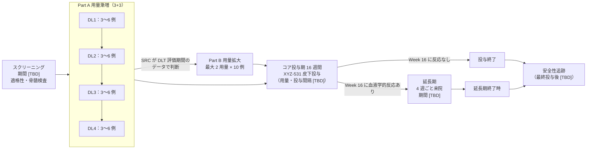

# Title Page

| 項目 | 内容 |
|---|---|
| 試験の正式名称 | 免疫抑制療法に不応の重症再生不良性貧血患者を対象とした XYZ-531（TPO 受容体作動性モノクローナル抗体）皮下投与の非盲検、用量漸増及び用量拡大、多施設共同第 1 相試験 [USER][DERIVED] |
| 略称 | [TBD] |
| 治験実施計画書番号 | [TBD] |
| 相 | 第 1 相（ヒト初回投与［FIH］）[USER] |
| 治験薬 | XYZ-531：トロンボポエチン（TPO）受容体作動性のモノクローナル抗体。eltrombopag と同じく、内因性 TPO と競合しない部位に結合する。皮下投与 [USER] |
| 規制上の識別番号（治験計画届出番号、jRCT 番号） | [TBD] |
| 治験依頼者の名称及び所在地 | [TBD] |
| 治験調整医師／医学専門家 | [TBD] |
| 版・作成日・改訂 | 草案 第 0.1 版、2026-10-25、改訂なし [DERIVED] |
| 実施国 | 日本 [USER] |

**秘密保持に関する記載.** 本書は治験依頼者の秘密情報を含む。治験審査委員会（IRB）による審査、治験責任医師・治験分担医師及び治験協力者による治験の実施、並びに参加候補者へのインフォームド・コンセントの取得に必要な範囲を除き、治験依頼者の書面による許可なく第三者に開示してはならない [STD]。

> 【草案についての注記】本書は「clinical-trial-protocol-skill v001.2」を第 1 相に拡張して作成した予備的な草案である。各段落・表の行の末尾の角括弧は出典ラベル（[USER] 利用者の設計、[CTG:…] ClinicalTrials.gov の登録情報、[PACK:aplastic_anemia] 下書きの疾患パック、[PRIOR:…] 公表資料、[STD] 規制・GCP の定型、[INSTR:…] 評価尺度の版、[DERIVED] 作成者が膨らませた記述（要レビュー）、[TBD] 治験依頼者が埋める値）を示す。設計上の判断とその理由は `design_decisions.md`（D1〜D12）に記録した [DERIVED]。

# 1 PROTOCOL SUMMARY

## 1.1 Protocol Synopsis

**試験の目的の要約.** 重症再生不良性貧血（SAA）は、免疫を介した造血幹細胞・前駆細胞の障害による致死的な骨髄不全である。ウマ抗胸腺細胞グロブリン（ATG）とシクロスポリン（CsA）を中心とする免疫抑制療法（IST）に不応の患者には治療選択肢が限られ、輸血依存と出血・感染のリスクが続く [PRIOR:NDA22291-S021:clinical-review-1.2][CTG:NCT00922883:brief_summary]。TPO 受容体作動薬（TPO-RA）は IST 不応例で 3 系統の血球回復をもたらすことが示されている [PRIOR:NDA22291-S021:label-14.3]。XYZ-531 は TPO 受容体を刺激するモノクローナル抗体であり、抗体の長い半減期により投与間隔を延ばせる可能性がある [USER][DERIVED]。本試験は、XYZ-531 をヒトに初めて投与し、IST に不応の SAA 患者での安全性・忍容性、薬物動態（PK）、免疫原性及び血液学的反応の予備的な兆候を評価し、拡大パート及び以後の試験の推奨用量を選ぶことを目的とする [USER][DERIVED]。

**目的、評価項目及び estimand.** 各評価項目の 5 属性は第 3 節に示す [DERIVED]。

| ID | 区分 | 評価項目 | 時点 |
|---|---|---|---|
| P1 | 主要 | Part A の DLT 評価期間における用量制限毒性（DLT）の発現 | DLT 評価期間 |
| P2 | 主要 | 治験薬投与下で発現した有害事象（TEAE）の発現割合と重症度（NCI CTCAE v6.0 で評価） | Week 16 |
| S1 | 副次 | XYZ-531 の単回及び反復皮下投与後の血清中薬物動態パラメータ（Cmax、Tmax、AUC、t1/2、Ctrough） | Week 16 |
| S2 | 副次 | XYZ-531 に対する抗薬物抗体（ADA）及び中和抗体の発現割合 | Week 16 |
| S3 | 副次 | Week 16 に血液学的反応を示した参加者の割合 | Week 16 |
| S4 | 副次 | Week 8 に血小板反応を示した参加者の割合 | Week 8 |
| S5 | 副次 | Week 16 までに血小板輸血非依存（8 週間以上連続して血小板輸血なし）を達成した参加者の割合 | Week 16 |
| E1 | 探索 | 血小板数、ヘモグロビン、好中球数及び網赤血球数のベースラインからの経時的変化 | Week 16 |
| E2 | 探索 | 血液学的反応までの期間及び血液学的反応の持続期間 | 延長期終了時 |
| E3 | 探索 | クローン進展（骨髄の新たな染色体異常、MDS/AML、PNH クローンの拡大）の発現割合 | 延長期終了時 |

主要目的は安全性・忍容性の評価と、Part B 及び以後の試験の推奨用量の選択であり、仮説検定は行わない [USER][STD]。副次評価項目 S3 には、中間事象（新たな免疫抑制療法、HSCT 又は他の TPO 受容体作動薬の開始等）を composite 戦略で扱う estimand を置く（第 3.2 節）[DERIVED]。

**試験デザインの概要.** 本試験は、日本の多施設で実施する非盲検、単群（用量コホートの逐次登録）の第 1 相試験であり、Part A（用量漸増）と Part B（用量拡大）から成る [USER]。
- Part A：3+3 法で用量を漸増する。1 コホート 3〜6 例。計画上は 4 用量段階を想定する（実際の段階数と各用量は [TBD]）[USER][STD][CTG:NCT02094417:arm_doses]。
- Part B：Part A で安全性評価委員会（SRC）が選んだ最大 2 用量で、各 10 例を追加して安全性・PK・血液学的反応の推定精度を高める [USER][CTG:NCT02094417:enrollment]。
- 投与：XYZ-531 を皮下投与する。開始用量（最小予測生物学的作用量［MABEL］に基づく）、用量段階及び投与間隔は [TBD]。投与間隔は参加者の利便性のため長い方が望ましい [USER]。
- 期間：スクリーニング期（[TBD]）、コア投与期 16 週間、Week 16 に血液学的反応を示した参加者は延長期（期間 [TBD]）で投与を継続できる。最終投与後の安全性追跡期間は XYZ-531 の半減期に基づき [TBD] とする [PRIOR:NDA22291-S021:label-2.3][CTG:NCT00922883:brief_summary]。

**参加者数.** 最大 44 例（Part A 12〜24 例、Part B 最大 20 例）。DLT 評価不能の参加者は Part A で補充する（第 10.11 節）[CTG:NCT02094417:enrollment][STD]。

**群と投与期間.** 単群：XYZ-531 皮下投与（用量・投与間隔 [TBD]）[USER]。コア投与期 16 週間で血液学的反応がなければ投与を中止する [PRIOR:NDA22291-S021:label-2.3]。背景治療として、スクリーニング時に安定用量のシクロスポリン又は蛋白同化ステロイドはコア投与期を通じて同じ用量で継続してよい [CTG:NCT00922883:eligibility_criteria][CTG:NCT02148133:eligibility_criteria]。

**主な適格基準.** 18 歳以上 [CTG:NCT02148133:minimum_age]。重症再生不良性貧血（診断時に骨髄細胞密度 < 30%［リンパ球を除く］、かつ好中球数 < 0.5 × 10^9/L、血小板数 < 20 × 10^9/L、網赤血球数 < 20 × 10^9/L のうち 2 項目以上）[USER][PRIOR:NDA22291-S021:summary-review]。ATG を含む IST を 1 コース以上受けて反応が不十分 [CTG:NCT00922883:eligibility_criteria]。スクリーニング時の血小板数 ≤ 30 × 10^9/L [CTG:NCT00922883:eligibility_criteria]。TPO-RA の治療歴は問わないが、治療歴がある場合は不応又は不耐であったことが確認できること [USER]。主な除外基準は、先天性骨髄不全症候群、骨髄の染色体異常・MDS・AML、PNH 顆粒球クローン ≥ 50% 又は溶血優位の PNH、1 年以内の動静脈血栓症、コントロール不良の感染症、HSCT の予定である（第 5 節）[CTG:NCT02773290:eligibility_criteria][PACK:aplastic_anemia]。

**統計手法の要約.** 仮説検定は行わない。安全性解析対象集団で、DLT と TEAE を用量段階別・パート別に集計する。血液学的反応の割合は、用量段階別に Clopper–Pearson 法の正確な 95% 信頼区間とともに示す。評価不能の参加者は非反応とする（NRI）。PK は非コンパートメント解析で算出する。TPO-RA 既治療（不応・不耐）例と未治療例は分けて記述する（第 10 節）[STD][USER][PACK:aplastic_anemia]。

**DLT の定義（要約）.** DLT 評価期間に発現し、XYZ-531 との因果関係が否定できない次の事象を DLT とする：(a) CTCAE v6.0 で Grade 3 以上の非血液毒性（支持療法で [TBD] 日以内に Grade 1 以下に回復する Grade 3 の悪心・嘔吐・下痢を除く）、(b) 血栓塞栓症（Grade を問わない）、(c) ALT 又は AST の [TBD] × ULN 超の上昇、又は ALT 若しくは AST > 3 × ULN と総ビリルビン > 1.5 × ULN の同時発現、(d) 血小板数 > 400 × 10^9/L、(e) Grade 3 以上の過敏症又は注射部位反応、(f) 骨髄の新たな染色体異常又は芽球の増加、(g) その他 SRC が用量制限的と判断した毒性。原疾患による血球減少の悪化は、SRC が別に判断しない限り DLT としない。完全な定義は第 6.4 節に示す [STD][PRIOR:NDA22291-S021:label-6.1][PRIOR:NDA22291-S021:label-2.3][DERIVED]。

**参加者内の用量調整と中止（要約）.** 血小板数が 200〜400 × 10^9/L になれば 1 段階減量（又は投与間隔の延長）、> 400 × 10^9/L になれば < 150 × 10^9/L に下がるまで休薬し、1 段階下の用量で再開する。ALT 又は AST > 6 × ULN では休薬する。血栓塞栓症では投与を恒久的に中止する。Week 16 までに血液学的反応がない場合、及び骨髄に新たな染色体異常が認められた場合は投与を中止する（後者は SRC で検討）[PRIOR:NDA22291-S021:label-2.3][DERIVED]。

**中間事象の扱い（要約）.** 新たな免疫抑制療法、HSCT 又は他の TPO 受容体作動薬の開始、及び背景治療のシクロスポリン又は蛋白同化ステロイドの用量変更は、以後を非反応とする（composite）。XYZ-531 の投与の恒久的な中止の後も血球数を収集し、そのまま使う（treatment policy）。反応判定前の除外期間内の輸血又は G-CSF の使用があった値は反応の確認に使わない [DERIVED][PRIOR:NDA22291-S021:clinical-review-p41]。

**試験の中止基準（要約）.** 試験全体として、DL1 で DLT が 2 例以上、治験薬との関連が否定できない死亡、又は SRC が参加者の安全上の懸念を認めた場合は、新規登録と投与を一時停止し、治験依頼者は規制当局と IRB に報告する（第 4.4 節、第 11 節）[STD][DERIVED]。

**委員会.** 治験依頼者の医学専門家、参加施設の治験責任医師及び [TBD] で構成する安全性評価委員会（SRC）が、各コホートの DLT 評価期間終了後に全データを確認し、次の用量段階への移行・同一用量でのコホート拡大・漸増の中止、及び Part B の用量の選択を決める。独立データモニタリング委員会は置かない（単群・非盲検・小規模のため）[STD][DERIVED]。

## 1.2 Trial Schema

図の説明：用量段階の数（4 段階）は計画上の仮定であり、最終的な段階数・用量・投与間隔は [TBD] とする [CTG:NCT02094417:arm_doses][USER]。各参加者は登録されたコホートの用量で投与を開始する。参加者内の用量変更は第 6.4 節の血小板数・肝機能に基づく減量・休薬の規則に限る [DERIVED]。主要評価項目の時点は、P1 が DLT 評価期間、P2 が Week 16 である [USER][STD]。割付比・層別はない（単群）[USER]。

**用量漸増の規則（3+3）.** 各用量段階で 3 例を登録し、DLT 評価期間に DLT が 0/3 なら次の用量段階へ進む。1/3 なら同じ用量段階に 3 例を追加し、1/6 なら次の用量段階へ進む。2 例以上に DLT が出たら（≥ 2/3 又は ≥ 2/6）その用量段階は最大耐量（MTD）を超えたとみなし、1 段階下の用量段階を 6 例で確認する [STD]。コホート内の最初の 1 例（センチネル）は単独で投与し、[TBD] 日間の安全性を確認してから残りの参加者に投与する [STD][DERIVED]。

## 1.3 Schedule of Activities

表 1-1 コア投与期（Part A 及び Part B 共通）[DERIVED][PACK:aplastic_anemia]

来院の許容幅：Day 2・Day 4 は ±0 日、Week 1〜Week 4 は ±1 日、Week 6〜Week 16 は ±3 日、延長期は ±7 日を目安とし、最終値は [TBD] とする [DERIVED]。投与日の欄（●*）は、投与間隔が確定するまで仮の印とする（投与間隔 [TBD]）[USER]。

| 手順 | スクリーニング（Day -28〜-1 を想定 [TBD]） | Day 1 | Day 2 | Day 4 | Week 1 | Week 2 | Week 3 | Week 4 | Week 6 | Week 8 | Week 10 | Week 12 | Week 14 | Week 16 |
|---|---|---|---|---|---|---|---|---|---|---|---|---|---|---|
| 同意取得 | ● | | | | | | | | | | | | | |
| 適格性の確認 | ● | ● | | | | | | | | | | | | |
| 病歴・前治療（IST・TPO-RA の反応/不耐を含む）| ● | | | | | | | | | | | | | |
| 身体所見・身長・体重 | ● | ● | | | | | | ● | | ● | | | | ● |
| バイタルサイン | ● | ● | ● | ● | ● | ● | ● | ● | ● | ● | ● | ● | ● | ● |
| 12 誘導心電図 | ● | ● | | | | | | ● | | | | | | ● |
| ECOG PS | ● | ● | | | | | | | | | | | | ● |
| 骨髄穿刺・生検（形態・細胞密度・細網線維・染色体 G 分染/FISH） | ● | | | | | | | | | | | | | ● |
| 血算・網赤血球 | ● | ● | ● | ● | ● | ● | ● | ● | ● | ● | ● | ● | ● | ● |
| 肝機能（ALT/AST/総ビリルビン） | ● | ● | | ● | ● | ● | ● | ● | ● | ● | ● | ● | ● | ● |
| 生化学・凝固 | ● | ● | | | ● | ● | | ● | ● | ● | ● | ● | ● | ● |
| 尿検査 | ● | ● | | | | | | ● | | ● | | | | ● |
| PNH クローン（フローサイトメトリー） | ● | | | | | | | | | ● | | | | ● |
| ウイルス検査（HBV・HCV・HIV） | ● | | | | | | | | | | | | | |
| 妊娠検査（妊娠可能な女性） | ● | ● | | | | | | ● | | ● | | ● | | ● |
| 輸血の記録 | ● | ● | ● | ● | ● | ● | ● | ● | ● | ● | ● | ● | ● | ● |
| 出血の評価 | ● | ● | ● | ● | ● | ● | ● | ● | ● | ● | ● | ● | ● | ● |
| XYZ-531 皮下投与（投与間隔 [TBD]） | | ● | | | | ●* | | ●* | ●* | ●* | ●* | ●* | ●* | |
| 投与後観察（投与後 [TBD] 時間） | | ● | | | | ●* | | ●* | ●* | ●* | ●* | ●* | ●* | |
| PK 採血 | | ●（投与前・投与後 [TBD]） | ● | ● | ● | ● | ● | ● | ● | ● | ● | ● | ● | ● |
| ADA・中和抗体 | | ●（投与前） | | | | | | ● | | ● | | | | ● |
| PD（血清 TPO 濃度ほか [TBD]） | | ● | | ● | ● | ● | | ● | | ● | | | | ● |
| DLT の評価（DLT 評価期間） | | ● | ● | ● | ● | ● | ● | ● | ●（[TBD] まで） | | | | | |
| 反応判定（血液学的反応） | | | | | | | | | | ●（Week 8：血小板反応） | | | | ●（Week 16：血液学的反応） |
| AE・併用薬 | ● | ● | ● | ● | ● | ● | ● | ● | ● | ● | ● | ● | ● | ● |

表 1-2 延長期・終了時・安全性追跡 [DERIVED]

| 手順 | 延長期（4 週ごと） | 延長期 12 週ごと | 延長期終了時 / 中止時 | 安全性追跡（最終投与後 [TBD]） |
|---|---|---|---|---|
| 身体所見・体重 | ● | | ● | ● |
| バイタルサイン | ● | | ● | ● |
| 12 誘導心電図 | | ● | ● | |
| 血算・網赤血球 | ● | | ● | ● |
| 肝機能 | ● | | ● | ● |
| 生化学・凝固 | ● | | ● | ● |
| PNH クローン | | ● | ● | |
| 骨髄穿刺・生検（染色体を含む） | | 24 週ごと [TBD] | ● | |
| 妊娠検査 | ● | | ● | ● |
| 輸血・出血の記録 | ● | | ● | ● |
| XYZ-531 皮下投与 | ●（投与間隔 [TBD]） | | | |
| PK 採血（投与前） | | ● | ● | ● |
| ADA・中和抗体 | | ● | ● | ● |
| 反応の持続の評価 | ● | | ●（延長期終了時） | |
| AE・併用薬 | ● | | ● | ● |

表 1-3 PK・ADA・PD の採血時点（Part A の全参加者及び Part B の全参加者）[STD][DERIVED]

| 時点 | PK（血清中 XYZ-531 濃度） | ADA・中和抗体 | PD（血清 TPO 濃度ほか） | 備考 |
|---|---|---|---|---|
| Day 1 投与前 | ● | ● | ● | 基線の値。ADA は既存抗体の確認にも使う |
| Day 1 投与後 [TBD] 時間 | ● | | | 皮下投与のため Tmax の想定で決める |
| Day 2 | ● | | | 単回投与後の吸収相 |
| Day 4 | ● | | ● | Cmax 付近を想定 [TBD] |
| Week 1 | ● | | ● | |
| Week 2 | ●（投与前） | | ● | 2 回目投与があればトラフ |
| Week 3 | ● | | | 消失相 |
| Week 4 | ●（投与前） | ● | ● | |
| Week 6〜Week 14 の各来院 | ●（投与前） | Week 8 のみ | Week 8 のみ | 反復投与のトラフ（Ctrough） |
| Week 16 | ● | ● | ● | コア投与期の終わり |
| 延長期 12 週ごと | ●（投与前） | ● | | |
| 延長期終了時 / 中止時 | ● | ● | | |
| 安全性追跡 | ● | ● | | ADA は最終投与後の遅発性の陽転を確かめる |
| 臨床的に必要な時（過敏症、反応の消失、予期しない血小板減少） | ● | ● | ● | 中和抗体による内因性 TPO への交差反応を調べる（第 8.6 節） |

**SoA の注記.**
1. DLT 評価期間（初回投与から [TBD] 日）は Part A の参加者で DLT を判定する期間である。Part B の参加者も同じ期間の有害事象を記録するが、漸増判断には使わない [STD][DERIVED]。
2. 骨髄検査の時点（スクリーニング、Week 16、延長期の規定時点、延長期終了時又は中止時）は、クローン進展の評価のため FDA の審査で求められた監視（基線と規定時点の骨髄検査）に合わせた [PRIOR:NDA22291-S021:clinical-review-8.8.1]。スクリーニング前 [TBD] 週以内に実施した骨髄検査の結果は、細胞密度と染色体分析がそろっていれば代用してよい [DERIVED]。
3. 肝機能は用量調整中に 2 週ごと以上の頻度で測定する。これは同じ作用機序の既承認薬の監視の頻度に合わせた [PRIOR:NDA22291-S021:label-5.2]。
4. 反応判定に使う血球数は、第 3 節の除外期間（輸血・G-CSF の後）に当たらない値とする [PRIOR:NDA22291-S021:clinical-review-p41]。
5. PK の採血時刻の詳細（単回投与後の密な採血、反復投与時のトラフ）は、XYZ-531 の予測半減期が決まった後に [TBD] として PK マニュアルに定める [TBD]。
6. 中止した参加者も、同意を撤回しない限り、Week 16 及び安全性追跡の来院を続ける（treatment policy のデータ収集）[STD]。
